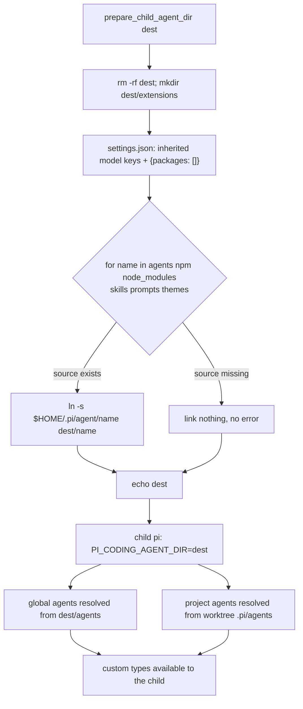

# Design: custom agent definitions in the child agent directory

## Summary

`prepare_child_agent_dir()` (`scripts/_sub-common.sh`) builds the isolated Pi
agent directory a spawned child runs with (`PI_CODING_AGENT_DIR`). It links
the user-level non-extension resources (`auth.json`, model files, `skills`,
`prompts`, `themes`, …) but not `agents/`. Pi resolves global custom agent
definitions from `<agent dir>/agents/<name>.md`, so a child saw only the
built-in agent types and had to inline or substitute the `nff-*` agents the
orchestrator flow names (evidence: the `riak-t-273-auto-offer-routes` child
in this task's brief, which inlined phases 1-3 and substituted
`general-purpose` for `nff-audit`).

The fix is one more entry in the existing symlink loop: `agents` is linked
from `$HOME/.pi/agent/agents` into the prepared directory, under exactly the
same existence rule as the other names — a missing source directory links
nothing and is not an error.

Nothing else changes. `extensions/` stays a real, empty directory,
`settings.json` keeps `packages: []`, and `@tintinweb/pi-subagents` remains
the one extension a child loads, via `-e` on the launch line. Project-level
agent definitions (`.pi/agents/*.md` in the child's worktree) are discovered
from the child's working directory, not from the agent dir, and pi's
precedence keeps project-level definitions overriding global ones — so
linking the user-level directory cannot shadow them, and the function never
touches the worktree.

## Entities

| Entity | Change |
|---|---|
| `prepare_child_agent_dir()` (`scripts/_sub-common.sh`) | `agents` joins the linked directory names (`npm node_modules skills prompts themes`); no new code path |
| `specs/child-agent-definitions/` | new feature + this design |
| `tests/sub-common.test.sh` | new behavioural tests, `[child-agent-definitions REQ-1]`…`[REQ-5]`, reusing the existing isolated-`$HOME` harness |

## Behaviour and data flow

`agents` is a directory of `<name>.md` definitions, so it belongs to the same
loop as `skills`/`prompts`/`themes` (which already uses the `-e || -L` guard),
not to the single-file loop. Symlinking preserves live edits to the user's
definitions and keeps the prepared directory cheap to build and remove.

## Plan

1. RED: add the behavioural tests to `tests/sub-common.test.sh` and run them
   against the unmodified `_sub-common.sh` (`[REQ-1]`/`[REQ-4]` fail).
2. GREEN: add `agents` to the linked directory-name loop in
   `prepare_child_agent_dir()`; rerun the suite.
3. Run the full test suite (every `tests/*.test.sh`) plus `shellcheck` and
   `bash -n` on the touched files.

## Proposed changes

| File | Change |
| --- | --- |
| `scripts/_sub-common.sh` | `agents` added to the `npm node_modules skills prompts themes` loop |
| `specs/child-agent-definitions/child-agent-definitions.feature` | atomic scenarios `[REQ-1]`…`[REQ-5]` |
| `specs/child-agent-definitions/child-agent-definitions-design.md` | this document |
| `tests/sub-common.test.sh` | five new tests (definition visibility, isolation, missing source, project-level source untouched, lint) |

## Best practices

- **One list, one rule.** The new name rides the existing loop and its
  existence guard — no bespoke handling, no second place to keep in sync.
- **Isolation is asserted, not assumed.** The isolation tests (empty real
  `extensions/`, `packages: []`) run next to the new one, so a future widening
  of the loop cannot silently restore packages.
- **Never touch the worktree.** Project-level agents stay the worktree's
  business; the change only widens the user-level link set.

## Decision strengths and weaknesses

- **Strengths.** Minimal (one word in a list), intent-preserving, no new
  failure mode (a missing `agents/` degrades to exactly today's behaviour),
  and the resources the child already retained stay intact. It also removes
  the workaround pressure seen in `riak-t-273` (inlining `nff-*` phases and
  substituting `general-purpose` for `nff-audit`).
- **Weaknesses.** The child now sees whatever definitions the user has
  installed, including the built-in-named `Explore`/`Plan`/`general-purpose`
  files; that is the point (the user-level set is what the orchestrator
  intends children to use), but it does mean a user-level definition with the
  same name as a project-level one must defer to the project one — which is
  pi's documented precedence, not this script's decision.

## Audit note (code-auditor, step 2)

An independent, read-only audit of the landed change (feature file + source +
tests, blind-then-rationale) returned **no outstanding Strong
recommendations**: the change adds one name to a data-driven list, introduces
no new code path, and leaves the interface unchanged. It verified at runtime
that the subagents extension resolves global agents from the agent dir first
and then `<cwd>/.pi/agents`, so project-level definitions still win.

- **Declined (per the skill's escape hatch):** extracting a shared
  `assert_lint_clean` helper for the per-spec lint gate (an established local
  convention), and extending the `prepare` harness with an optional cwd for
  the REQ-4 test (single use).
- **Applied:** dropped the reliance on the suite's pre-existing `jq_ok`
  helper (it returns 0 in both branches, so `jq_ok || return 0` never skips);
  REQ-2 now guards its own jq use and skips only the packages assertion when
  jq is absent. Docs corrected (five, not four, new tests).

Re-verified after the audit: `tests/sub-common.test.sh` green, the full
`tests/*.test.sh` suite green, `shellcheck` + `bash -n` clean on both touched
files.
