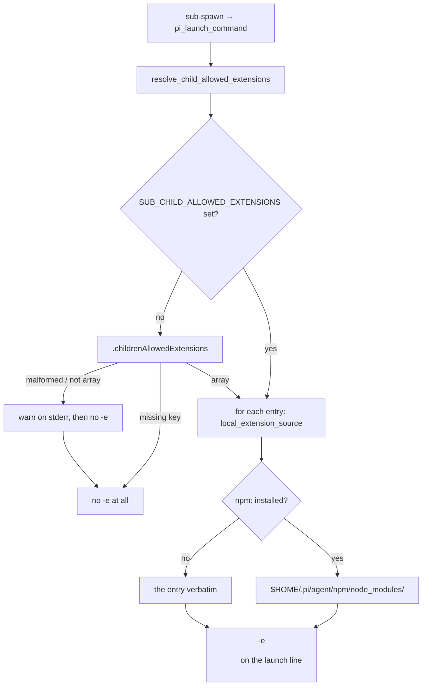

# Design: child allowed extensions (sub-spawn, _sub-common.sh)

## Summary

A spawned child boots with `--no-extensions` and an isolated agent directory
whose `settings.json` keeps `"packages": []` (`specs/child-agent-definitions`).
That isolation is deliberate — it keeps the worktree's own `.pi/extensions`
(telegram bridge, dev-server, …) and every user package out of a child — but it
also hides *model* providers that an installed pi package supplies by calling
`pi.registerProvider()`. A child asked to run on such a model (`--model
<package model>`, e.g. one mapped by a difficulty level) cannot resolve it and
pi exits at startup with `Error: Model "…" not found`, so the spawn dies before
pi boots.

The fix keeps the isolation exactly as it is and adds one explicit channel:
the **allowed extensions** named in configuration are passed to pi on the
child's launch line with `-e <source>`. Only those load; `packages` stays `[]`
and
`--no-extensions` stays on the line.

## Entities

- **`config.json`** — top-level `childrenAllowedExtensions` array (sibling of
  `taskLevels`; unknown keys stay ignored by level resolution):
  `{"childrenAllowedExtensions": ["npm:pi-free-provider", …]}`. Entries use
  pi's own extension/package source syntax (`npm:<name>`, `git:…`, a path, a
  URL). The shipped values live in the file; this document names none.
- **`scripts/_sub-common.sh`** (modified):
  - `npm_installed_dir <name[@version]>` — the package's directory under
    `$HOME/.pi/agent/npm/node_modules`, or failure;
  - `local_extension_source <source>` — an installed `npm:` entry becomes that
    directory (so a spawn loads it offline and does not re-install it into the
    throwaway child agent dir); everything else passes through verbatim;
  - `resolve_child_allowed_extensions` — precedence
    `SUB_CHILD_ALLOWED_EXTENSIONS` (set ⇒ wins, even empty; whitespace/comma
    separated) > `.childrenAllowedExtensions` in the levels config > none.
    Malformed JSON or a non-array key warns on stderr (naming `config.json`)
    and yields nothing; a missing key is not an error. Always exits 0.
  - `pi_launch_command` — appends one `-e <quoted source>` per resolved entry,
    before `--model/--thinking`,
    `--approve`, and the kickoff, so pi parses them as options.
- **`tests/child-model-resolution.test.sh`** (new) — one test per scenario,
  hermetic (fixture configs via `SUB_LEVELS_CONFIG`, fixture `$HOME` with and
  without a fixture npm install).

## Behaviour and data flow



Launch line order:

```
pi -n <task> --no-extensions [-e <allowed>…]
   [--model <m>] [--thinking <l>] --approve '<kickoff>'
```

## Tests

`tests/child-model-resolution.test.sh` maps 1:1 onto
`specs/child-model-resolution/child-model-resolution.feature` ([REQ-37]…[REQ-42],
[REQ-48]). The shipped `config.json` and the real pi install are never the
subject under test: every config is a fixture, `$HOME` is a scratch agent dir,
and the model ids in fixtures are neutral.

## Risks and limits

- A configured package that itself needs another extension loaded first still
  loads only itself; the list is additive and explicit by design.
- An `npm:` entry installed only in a *different* package root is passed to pi
  verbatim, which may install it into the child's agent dir at startup —
  `-e npm:<name>` is pi's own path, so behaviour matches a manual launch.
- The list is not inherited from the global settings' `packages`: isolation is
  the point, so every allowed extension is named explicitly (user decision at
  the specs gate, 2026-11-07).
