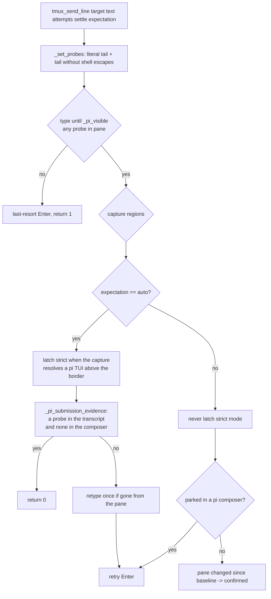

# Fix: confirm a launch line in a shell pane — design

Bug fix. Scenarios: [`fix-launch-confirm.feature`](fix-launch-confirm.feature)
([REQ-1](file://specs/fix-launch-confirm/fix-launch-confirm.feature:33) …
[REQ-6](file://specs/fix-launch-confirm/fix-launch-confirm.feature:84)).
Sibling specs, unchanged: `specs/fix-send-confirm/` (transcript evidence for a
pi pane) and `specs/fix-parked-prompt/` (never strand a prompt).

## Entities

| Entity | Change |
|---|---|
| `tmux_send_line` (`scripts/_sub-common.sh`) | new 5th positional `expectation`: `auto` (default, unchanged pi behaviour) or `shell`; an unknown value dies |
| `tmux_send_shell_line` (new) | the launch seam: owns the shell expectation and the retry knobs, so no caller restates them |
| `_shell_unescape`, `_set_probes`, `_has_probe`, `_pi_submission_evidence` | the probe is now a *set* of forms: the literal typed text and the same text without the shell's escaping |
| `sub-spawn.sh`, `start-main.sh` | launch lines go through `tmux_send_shell_line` |

## Behaviour

`auto` keeps every guarantee of `f9652b6`: retyping happens **only** inside the
strict branch, which the `shell` expectation never enters — so a launch line can
never be typed into a pi that has since booted (REQ-2). `shell` adds one guard
the `auto` path already had: a change is never evidence while the text is shown
parked in a pi composer (REQ-4), and Enter keeps being retried so nothing is
stranded.

## Plan

1. Pure-bash `_shell_unescape` (`\x` → `x`), flattened and tail-clamped like
   the literal probe; both forms live in the `_PI_PROBES` array.
2. Every `grep -F "$probe"` call site becomes a `_has_probe` (any form);
   `_pi_submission_evidence` keeps the stricter rule — a form in the composer
   blocks the evidence whatever else matched.
3. `expectation` argument: `auto` | `shell`, anything else dies (a typo must
   not silently fall back to the mode that caused the incident).
4. `tmux_send_shell_line` wraps the launch shape; `sub-spawn.sh` /
   `start-main.sh` call it.
5. Tests: `tests/sub-common.test.sh` gains the `boot` / `boot-blank` /
   `boot-park` pane fixtures and REQ-1…REQ-4; `tests/launch-confirm.test.sh`
   covers the end-to-end spawn (REQ-5) and shellcheck (REQ-6).

## Decisions

- **Probe variants instead of stripping backslashes everywhere.** A literal
  match is still needed: the shell echo (and pi's composer) show the typed
  bytes. Stripping escapes globally would break the shell-pane visibility
  check; matching both forms fixes the transcript case without that cost.
- **A shell expectation, not a heuristic.** Deciding "this text looks like a
  launch line" from its content is a guess; the caller knows which pane it
  typed into. Explicit beats clever, and the default keeps today's behaviour
  for every existing caller.
- **A wrapper for the launch shape.** `tmux_send_line`'s 5th positional would
  make both callers restate `4 1 shell`; restating a call is how a launch loses
  its confirmation. The wrapper is one line and owns the knobs.
- **`shell` mode never latches strict mode.** The launch line *is* the pi
  command; requiring it to appear in a transcript that only ever receives
  composer messages is unsatisfiable by construction.
- **Probe set as module state** (`_PI_PROBES`, filled by `_set_probes`), read by
  `_has_probe` / `_pi_composer_holds` / `_pi_submission_evidence`. Same pattern
  as the `_pi_*` region globals: one capture fills them, every predicate reads
  them, and no predicate can read an unset variable.
- **Weaknesses.** REQ-3 trusts that pi echoes the user turn with the shell's
  escapes resolved (it does: the shell, not pi, strips them — and a probe that
  matched neither form only costs a retype, never a false success); REQ-1 keeps
  the legacy change check, which proves the pane reacted — unavoidable for a
  shell line and already specified by `fix-send-confirm` [REQ-6].

## Audit notes

An independent audit (against this feature file, the sibling specs and the diff)
found one **Strong** issue, fixed here: the fake pane echoed the *whole* command
line, unescaped, so both mechanisms passed for the wrong reason — deleting the
shell expectation entirely left the suite green. The fakes now write only what pi
actually shows (the kickoff, from a fixture constant — no re-implementation of
`_shell_unescape`, which would have confirmed a systematically wrong unescaper),
and REQ-1/REQ-2 use a pane where the kickoff is *not yet rendered*, so only the
shell confirmation can settle the send. Verified by mutation (every scenario
was run against each implementation):

| Implementation | REQ-1 | REQ-2 | REQ-3 | REQ-4 | REQ-5 |
|---|---|---|---|---|---|
| pre-change (`git show HEAD:scripts/_sub-common.sh`) | fail | fail | fail | pass | fail |
| shell expectation neutralised | **fail** | **fail** | pass | pass | **fail** |
| as shipped | pass | pass | pass | pass | pass |

Smaller audit findings that were applied: `_pi_submission_evidence` folded into
`_has_probe` instead of a second copy of the loop; the "the form the shell hands
the program" comment narrowed to what `_shell_unescape` actually resolves
(`$'…'` control-character forms are out of scope); an unknown expectation now
dies instead of degrading to `auto`; the restated-defaults friction answered
with the `tmux_send_shell_line` wrapper. Rejected: passing the probe list back
as a parameter (it would undo the region-global locality the file already
relies on); raising a false-"sent" risk for composer sends from the extra probe
form — it needs an empty composer plus a colliding transcript string, and REQ-3
asks for it.