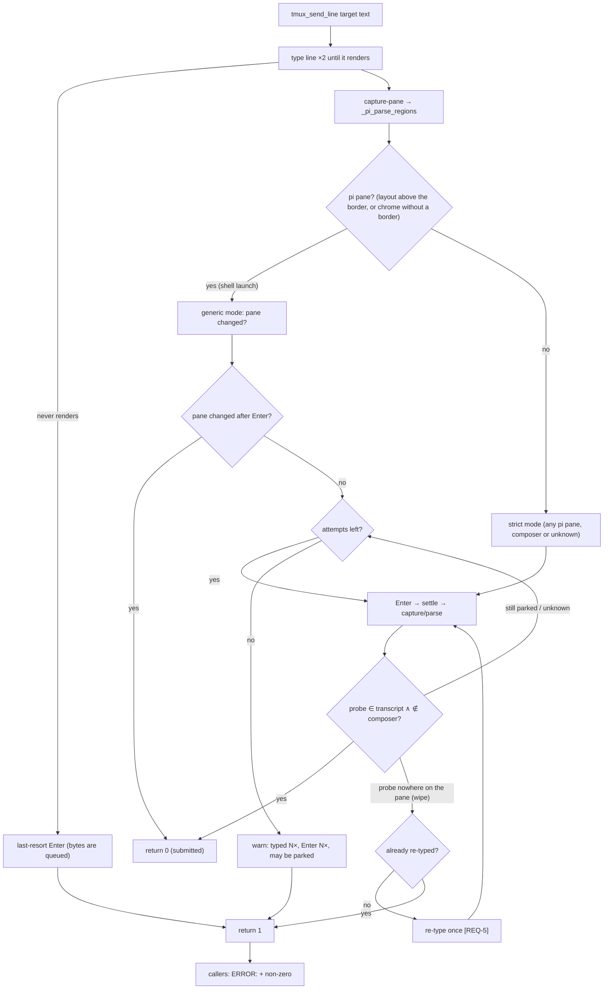

# Design: never strand a prompt (tmux_send_line region model + decision)

## Abstract

`tmux_send_line` (`scripts/_sub-common.sh`) already required positive
submission evidence for a pi pane, but it derived the evidence from a region
model that could classify a parked composer as transcript. When that happened
the helper took the "the visible copy of the text is in the transcript, not
the composer" branch, warned, and **returned 1 without ever pressing Enter** —
the instruction stayed parked in the child's input box (reproduced
2026-10-17 on `pi-riak-250-review`). Two defects in the model and one in the
state machine are fixed here:

1. the composer block is found by an *unbounded* walk up from the status
   border and is lost entirely when a single blank line separates it from the
   border (pi had not drawn the composer's top border in the instant after
   typing);
2. a transcript that runs into the border (no blank separator) is swallowed
   wholesale into the "composer";
3. the state machine had a branch that returned before the Enter loop, and its
   re-type condition could in principle fire on an ambiguous capture.

New behaviour: the composer is a **bounded** block (walk up from the border,
skipping a blank gap when the block directly above the border is absent, and
rejecting pi's chrome rows such as `── ⠴ Working ──`); and any *visible* text
in a pi pane is treated as **unknown**, never as sent — the helper always
presses Enter and confirms only from submission evidence.

## Observed pane anatomy (verified against a live pane, 2026-10-17)

Bottom-up, idle/working child (`tmux capture-pane -t pi-riak-250-review`):

```
… transcript lines
  (blank)
  working row      ──── ⠴ Working ─────────────
  (blank)          ← the empty composer
  status border    ────────────────
  path line        ~/.treehouse/riak-t-f778a7/3/riak-t (task/riak…
  stats line       ↓85k ↑24k R2.3M CH96.6% …                 ← last line
```

A parked line occupies the composer row(s) **directly above the border**; the
transient shape that broke the parser is the same pane in the instant after
typing, where the composer's top border is not drawn yet and a blank line sits
between the typed text and the status border:

```
… transcript lines
  (blank)
  working row      ──── ⠴ Working ─────────────
  the typed line           ← composer, one row higher than usual
  (blank)                  ← the missing composer top border
  status border    ────────────────
```

## Entities

- **`scripts/_sub-common.sh`** (modified)
  - `_pi_dash_row` / `_pi_chrome_row` (new): pi's chrome rather than composer
    content — the status border (all dashes) and the bordered spinner row
    (`── ⠴ Working ──`, pi's Loader frames). Deliberately narrow: a line that
    merely starts and ends with `─` is content, or a parked line would be
    pushed into the transcript and confirmed as sent.
  - `_pi_unresolved_pi_pane` (new): a capture showing pi's chrome with no
    resolvable border is an incomplete pi frame, not a shell — confirmed only
    from evidence ([REQ-7]).
  - `_pi_visible` (new): bounded polling for "did the typed line render",
    because `send-keys` only queues bytes in the pane.
  - `_pi_parse_regions` (modified): the composer block is the run of
    non-chrome, non-blank lines directly above the status border, bounded to
    `_PI_COMP_MAX_LINES` (4 — the probe is the *tail* of the line, so the
    bottom window is what evidence needs), with its bottom edge the lowest
    non-blank line within `_PI_COMP_SCAN_LINES` above the border (a blank gap
    is tolerated, so a missing composer top border no longer collapses the
    region) ([REQ-1], [REQ-4]).
  - `tmux_send_line` (modified), same signature and return contract:
    1. Type the line until it renders (2 attempts, bounded polling) — a line
       that never renders gets one **last-resort Enter** before the failure,
       because its bytes are already queued ([REQ-9]).
    2. Decision capture: strict mode for every pi pane (recognized layout with
       the text above the border, or an unresolved pi frame) and the legacy
       change check only for a genuine shell. The branch that returned 1
       before any Enter is gone — visible-but-unproven is *unknown*, not
       *sent* ([REQ-2]).
    3. Enter loop, unchanged in shape: strict success = `probe ∈ transcript ∧
       probe ∉ composer`; a line gone from the *whole* pane and never in the
       transcript is re-typed **once** ([REQ-5]); otherwise retry Enter. The
       loop also latches strict mode the moment a capture resolves a pi
       layout.
    4. Final failure warns with the exact work attempted ("typed N time(s),
       Enter N time(s) … may still be parked in the composer") ([REQ-6]).
- **`tests/sub-common.test.sh`** (extended): the fake tmux gains a
  `gap` layout (composer one row above the border, blank gap between) and a
  `prefilled` transcript mode (the line already submitted); new tests for
  [REQ-1], [REQ-2], [REQ-3], [REQ-4], [REQ-5], [REQ-6].
- **`AGENTS.md`** (prose only): the "Every prompt must be confirmed as
  submitted" paragraph states the never-strand rule (Enter is always sent
  before a send is called unconfirmed). No test asserts document content.

## Data flow



## Plan

1. `_pi_chrome_row` + the bounded, gap-tolerant composer block in
   `_pi_parse_regions`.
2. `tmux_send_line`: drop the pre-Enter transcript bail-out, strict mode for
   every pi pane whose text is not below the border, counters for the final
   warning.
3. Tests: fake-tmux `gap` layout and `prefilled` transcript mode; five new
   behaviour tests plus parser assertions; the whole suite stays green.
4. `AGENTS.md`: one paragraph in the verified-send section.

## Sibling call sites (checked, not assumed)

| Call site | Pane at send time | Region model involved? |
|---|---|---|
| `sub-send.sh` | the child's pi TUI | yes — fixed by this change |
| `sub-report.sh` | the main session's pi TUI | yes — same helper, no separate logic to fix |
| `sub-fallback.sh` (`/model`, `/thinking`) | the child's pi TUI | yes — benefits; it also nudges with bare Enters and clears the composer on failure |
| `sub-spawn.sh` | a **shell** pane (pi has not booted; the kickoff is pi's argv, never typed into a composer) | no — `layout=0` → legacy change check, untouched |
| `start-main.sh` | the same shell-launch pane | no |

## Best practices

- **Never strand**: every visible-text path ends in an Enter; only evidence
  ends in success. The harmless action is the default.
- **Bounded evidence**: the composer window is bounded, so a mis-detected
  layout degrades to "unknown" (Enter, then evidence) instead of "sent".
- **Fail safe**: re-type only for a line that vanished from the whole pane —
  never from an ambiguous capture.
- **No new seams**: the parser stays a pure stdin→globals function, unit
  tested without tmux.

## Strengths / weaknesses

- Strengths: kills the whole class of "give up before Enter" strands; the
  bounded composer also removes the unbounded-swallow defect; the failure
  message now says what was attempted.
- Weaknesses: keyed to pi's current chrome wording (a renamed working row
  would make an idle pane's composer look non-empty — harmless: the probe is
  never in a chrome row, so the mode stays strict); the ambiguous case costs
  one harmless Enter and could, in the rare case of a pre-existing identical
  copy on screen, confirm a line whose keystrokes were lost (warned about by
  the "already visible" warning); the evidence rule needs pi to echo the
  submitted turn verbatim into the transcript; a future TUI redesign degrades
  to the legacy change check.

## Audit note

See `specs/fix-parked-prompt/audit.md` — an independent `reviewer` pass; its
one **Strong** finding (the never-rendered bail-out stranded a queued line
without pressing Enter) and three **Worth exploring** ones are fixed here, two
residuals are documented.