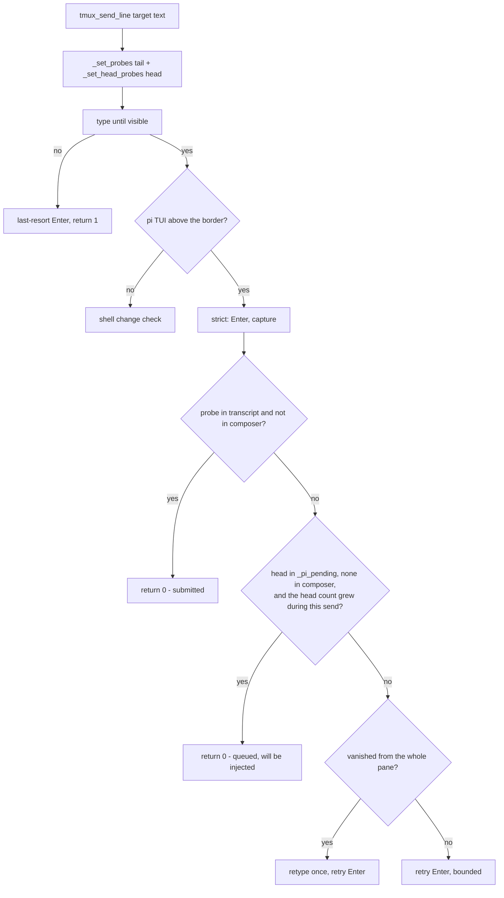

# Fix: confirm a notice pi queues behind a running turn — design

Bug fix. Scenarios: [`fix-pending-notice.feature`](fix-pending-notice.feature)
([REQ-1](file://specs/fix-pending-notice/fix-pending-notice.feature:38) …
[REQ-7](file://specs/fix-pending-notice/fix-pending-notice.feature:100)).
Sibling specs, unchanged: `specs/fix-send-confirm/` (transcript evidence for a
pi pane), `specs/fix-parked-prompt/` (never strand a prompt),
`specs/fix-launch-confirm/` (shell-pane launches) and
`specs/pr-action-watch/` (the watcher whose retries turned the miss into a
flood).

## Abstract

`tmux_send_line` (`scripts/_sub-common.sh`) knows three states of a typed
line: submitted (a probe reached the transcript ⇒ success), parked (a probe
sits in the composer ⇒ retry Enter), vanished (talk to nobody ⇒ retype once).
A fourth state was missing: pi accepting the line into its **pending-message
queue** while a turn is running (steering message). The pending display
renders that message as ONE line truncated to the pane width
(`TruncatedText(text, 1, 0)`), so the tail probe — for the PR watcher's
notices, the `[pr-watch <epoch>]` marker — is cut off, the line reads as
"vanished", and the helper re-types and fails. `sub-pr-watch.sh` retries the
unconfirmed notice every `PR_WATCH_RETRY_SECONDS` with a fresh epoch, and
each attempt appends another copy to the orchestrator's input queue.

The fix adds the missing state to the region parser and the verified send: a
line shown in pi's pending-message display (`Steering: …` / `Follow-up: …`)
counts as delivery — pi injects it as a turn — provided it has left the
composer and the queued copy is one THIS send added, and the pending lines are
kept out of the transcript region. One local predicate (`_pi_pending_holds`),
a growth guard (`_pi_pending_head_count`), one new region global
(`_pi_pending`), one extra branch in the strict confirmation path, and no
interface change: every existing caller (sub-report, sub-send, the watcher
through sub-report) keeps working unmodified.

## Entities and seams

| Entity | Change |
|---|---|
| `_pi_parse_regions` (`scripts/_sub-common.sh`) | fills `_pi_pending`: pi's pending-message display, flattened per line, the `Steering:` / `Follow-up:` marker stripped; skips those lines when building `_pi_trans` |
| `_pi_pending_row` (new) | classifies one pane line as a pending-display entry |
| `_set_head_probes` / `_has_head_probe` (new) | the pending display shows only the line's head, so it gets its own probe set: the first `_PI_HEAD_PROBE` flattened characters of each probe form |
| `_pi_pending_head_count` (new) | how many queued copies of the head the pending display holds; the caller compares it across the send |
| `_pi_pending_holds` (new) | delivery-pending evidence: recognized pi layout, a head probe in `_pi_pending`, and no copy parked in the composer |
| `tmux_send_line` | strict branch: after a capture, `_pi_submission_evidence` (submitted) OR `_pi_pending_holds` with a grown head count (queued) confirm the send; both are checked before the vanish/retype path |
| `_pi_pending` | new region global, reset with the others in `_pi_parse_regions` / `_pi_regions_of` |

Unchanged: `sub-report.sh`, `sub-send.sh`, `sub-pr-watch.sh`, the spawn
launch path (`tmux_send_shell_line`, expectation `shell` — a shell pane never
latches strict mode), the public interface of `tmux_send_line`.

## Behaviour and data flow



### The pending state in pi

While `session.isStreaming` (or compacting), pi's editor submit handler
queues the text as a steering message (`session.prompt(text,
{streamingBehavior: "steer"})`) and renders the queue between the transcript
and the status row:

```
Steering: <message, truncated to the pane width>…
↳ Alt+Up to edit all queued messages
── ⠴ Working ─────────────────────────────
<composer>
```

`_pi_parse_regions` records those lines separately as `_pi_pending`, *without*
the marker, one flattened line per queued message, and **excludes them from
`_pi_trans`**: a pending line is neither transcript content nor composer
content. The tail probe can match a pending line only when the whole message
happens to fit the pane width — for the watcher's ~200-character notices it
never does, which is the defect.

## Plan

1. Extend `_pi_parse_regions`: scan the capture for `Steering: ` / `Follow-up: `
   lines (`_pi_pending_row`), append each flattened message (marker stripped)
   to `_pi_pending`, and skip those lines when building `_pi_trans`; reset the
   global with the other regions (both in the parser and in the failed-capture
   path of `_pi_regions_of`).
2. Add `_PI_HEAD_PROBE`, `_PI_HEAD_PROBES`, `_set_head_probes`,
   `_has_head_probe`, `_pi_pending_head_count`; call `_set_head_probes "$text"`
   next to `_set_probes` in `tmux_send_line` and take the pre-Enter
   `pending_before` baseline from the decision capture.
3. Add `_pi_pending_holds` (layout recognized, pending line matches a head
   probe, composer does not hold the line).
4. In the strict branch of `tmux_send_line`, after `_pi_submission_evidence`
   fails and before the vanish check, confirm from `_pi_pending_holds` only
   when `_pi_pending_head_count` grew past `pending_before`.
5. Tests: the `tests/sub-common.test.sh` fake gains a `steer` pane mode and
   the parser/predicate scenarios ([REQ-1]…[REQ-3], [REQ-8], [REQ-7]); the
   `tests/sub-report.test.sh` fake gains the same mode ([REQ-4]); the
   `tests/pr-action-watch.test.sh` fake gains it for the main pane
   ([REQ-5], [REQ-6]).
6. `AGENTS.md`: the verified-send paragraph and the PR-watch note name the
   queued (pending) delivery state.

## Proposed changes

| File | Change |
| --- | --- |
| `scripts/_sub-common.sh` | `_pi_pending` region (excluded from `_pi_trans`), head probes, `_pi_pending_head_count`, `_pi_pending_holds`, strict-branch confirmation |
| `tests/sub-common.test.sh` | `steer` fake mode + [REQ-1]…[REQ-3], [REQ-8], parser and shellcheck scenarios |
| `tests/sub-report.test.sh` | `steer` fake mode + [REQ-4] |
| `tests/pr-action-watch.test.sh` | `steer` fake mode (pi-layout render) + [REQ-5], [REQ-6] |
| `specs/fix-pending-notice/` | this design + the feature file |
| `AGENTS.md` | pending-delivery wording in the verified-send and PR-watch notes |

## Constant values

- `_PI_HEAD_PROBE` = 20 flattened characters. `TruncatedText` keeps
  `paneWidth − len("Steering: ") − 3` characters of the message; the
  orchestrator pane is 50% of the screen, and 20 characters stay visible even
  on a ~40-column pane, while still separating a queued line from unrelated
  content. The head is **not** used as an identity — for tasks whose name is
  longer than the probe it cannot even carry the PR number; only a copy the
  send added (head count growth) confirms it.
- Reused: `_PI_PROBE_TAIL` = 60 (tail probe), `_PI_TYPE_ATTEMPTS` = 2,
  `_PI_VISIBILITY_TRIES` = 3, `_PI_COMP_MAX_LINES` = 4,
  `_PI_COMP_SCAN_LINES` = 2.

## Best practices

- **The missing state lives in the module that already owns the states.**
  Pending is classified by the same region parser and answered by the same
  strict branch as submitted/parked/vanished; no caller learns about pi's
  renderer.
- **Head and tail probes are separate sets.** The tail answers "did pi
  receive and render the whole line" (transcript); the head answers "is this
  line in the queue, rendered in truncated form". One set cannot answer both.
- **A parked copy always blocks pending evidence.** `_has_probe "$_pi_comp"`
  and `_has_head_probe "$_pi_comp"` are checked before `_pi_pending` is
  trusted, so an older queued copy of the same message can never confirm a
  line that is still sitting in the composer.
- **Only this send's queued copy counts.** `_pi_pending_head_count` is
  sampled before the first Enter and the confirmation requires it to grow, so
  a pre-existing queued message whose truncated head merely collides with the
  line's head cannot stand in for a vanished send (`[REQ-8]`) — the head is a
  locator, not an identity.
- **Pending lines are a region of their own.** The parser skips them when
  building `_pi_trans`, so the full text of a short queued message can never
  masquerade as transcript evidence; the pending predicate answers that
  question instead.
- **The queue is delivery, and the watcher's contract relies on it.**
  `sub-report.sh` returning 0 is what marks a review as notified; confirming
  a queued notice there is what makes the queue copies bounded (exactly one)
  without changing the watcher or its retry rules.
- **No new interface.** Every caller keeps its signature, wording and exit
  semantics; the change is invisible to `sub-report.sh`, `sub-send.sh` and
  `sub-pr-watch.sh`.

## Decision strengths and weaknesses

- **Strengths**: one fixed state removes the whole flood — the first queued
  notice is a confirmed delivery, so the event is marked seen and the
  watcher's next scans send nothing; terminal notices still exit the watcher
  after exactly one queued copy; a shell-pane launch and a parked prompt are
  untouched because pending evidence is strict-only and composer-guarded; the
  head-probe mechanism is renderer-local (`Steering:`/`Follow-up:` markers,
  flattened per line) and covered by the same fakes that already model pi's
  layout; the growth guard makes the confirmation belong to the send, not to
  the message text.
- **Weaknesses**: recognition depends on pi's pending display keeping its
  `Steering:` / `Follow-up:` markers and truncating to one line; a pi change
  there restores the pre-fix behavior (retype + failed notice, not a wrong
  success), and the watcher-level guard tests pin the shape the fix was
  written against. A head probe is 20 characters, so two different messages on
  the same PR share it; the growth guard closes the false-confirmation case, at
  the cost that a *concurrent* writer queueing a colliding head while this
  send's line is wiped would still read as this send's copy (pi-main has a
  single orchestrator writer, so this is theory, not practice). The parser
  treats any line starting with `Steering: ` as pending content — a transcript
  line shaped exactly like pi's pending marker plus a matching head could in
  principle match, but the composer guard, the growth guard and the transcript
  exclusion keep that from confirming an unsent prompt.

## Audit notes

The independent audit (feature file, source and tests; the design doc
deliberately unread) found one **Strong** defect, one test defect and one
inaccurate comment; all three are fixed in this change and covered by a new
requirement:

- **Strong — prefix-match false confirmation.** The first version confirmed a
  pending delivery from the 20-character head alone. Two notices on the same
  PR (review vs merge) share that head, so an older queued copy could confirm
  a send whose line had actually vanished — and the watcher then recorded the
  event as notified (`seen_reviews`) and never retried. Fixed by
  `_pi_pending_head_count`: the pending display is sampled *before* the first
  Enter and the confirmation requires the matching-copy count to grow. A
  pre-existing same-head copy no longer counts, and the fix is pinned by
  `[REQ-8]` (`t_pending_req8_same_head_stale_copy_is_not_evidence`, RED
  without the growth guard, GREEN with it).
- **Test defect.** `t_pending_req1_queued_message_confirms_without_retype`
  had accidentally folded its "must not reach the transcript" assertion into
  the previous `fail` message string, so it never executed. Split into its own
  condition.
- **Comment defect.** The head-probe rationale claimed the 20 characters carry
  "a notice's task name and PR number"; for kebab-case task names longer than
  the probe they carry the task-name prefix only. Corrected, and the design
  now states explicitly that the head is a locator, not an identity.
- **Worth exploring, applied anyway.** The audit noted the pre-existing
  double-region overlap (pending lines were still folded into `_pi_trans`, so
  a short queued message's visible text could satisfy
  `_pi_submission_evidence`). `_pi_parse_regions` now skips pending rows when
  building `_pi_trans`, which closes that path without touching any caller.
- **Accepted, not fixed.** pi's own compaction-flush failure path can clear a
  queue without replaying session steering messages (pi 1.3.0
  `interactive-mode.js`), so "pending will be injected" is a pi-level
  guarantee, not an absolute one; out of this change's scope. Concurrent
  writes with a colliding head are likewise out of scope (single orchestrator
  writer).

A verification pass on the applied fixes found **no remaining Strong
finding**, and its one Minor coverage note is closed too: the composer guards
were only exercised in combination, so the suite now pins them in isolation
with the `steer-parked` fake mode
(`t_pending_req2_new_pending_copy_with_parked_composer_is_not_confirmed` — a
*new* queued head, count grown, while the typed line still sits in the
composer; RED when either composer guard is removed, GREEN as shipped).
