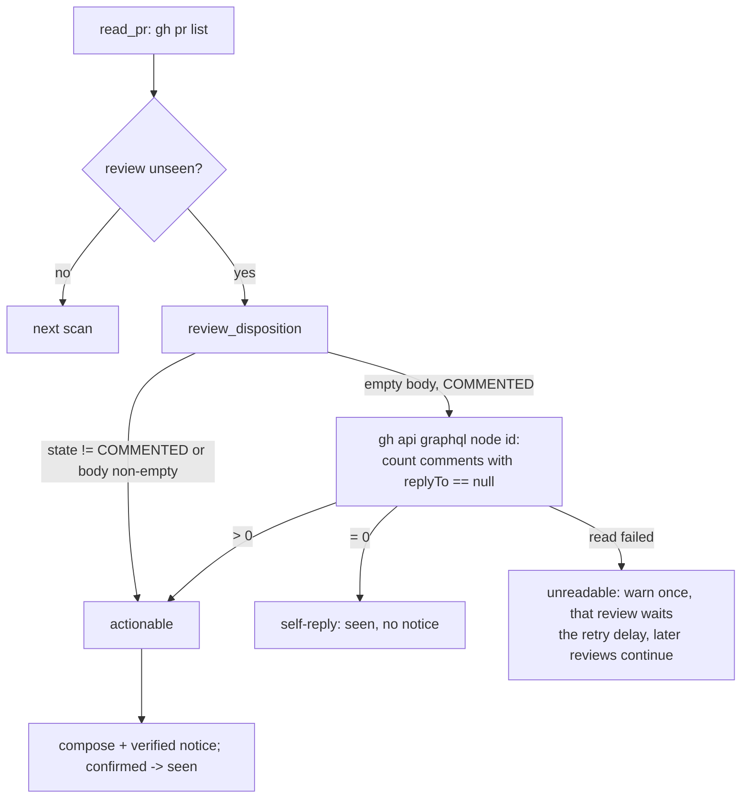

# Fix: never route a child's own review-comment replies back to it — design

Bug fix. Scenarios: [`fix-self-review-loop.feature`](fix-self-review-loop.feature)
([REQ-1](file://specs/fix-self-review-loop/fix-self-review-loop.feature:45) …
[REQ-7](file://specs/fix-self-review-loop/fix-self-review-loop.feature:100)).
Refines `specs/pr-action-watch/` [REQ-3] for `COMMENTED` reviews: a *reply* to
an existing review thread is not a submitted review, and must not become a
notice. Unchanged: `specs/fix-pending-notice/` (this delivery path),
`specs/fix-send-confirm/`, `specs/fix-parked-prompt/`.

## Abstract

Every child acts under the same GitHub account as the `gh` token, so author
identity cannot separate the reviewer from the child. A child replying to an
inline review comment produces a **synthetic `COMMENTED` review** (GitHub
records the reply as its own review object: review 5564195733 / comment
4308102832 on riak-t PR #263) with an empty review body and a fresh
`login|state|submittedAt` signature. The watcher notifies the orchestrator,
which routes the child's own words back to the child, which replies again —
a self-sustaining loop costing one child turn per round.

The fix classifies a `COMMENTED` review before notifying it, using data the
API actually exposes: a review is actionable when its body has content or it
carries at least one top-level inline comment (`replyTo` absent); a review
whose comments all reply to existing threads is recorded as handled and never
notified. The classification is a new seam, `review_disposition`, backed by
one read-only GraphQL query per unseen `COMMENTED` review with an empty body
— never part of the poll, never a mutation.

## Entities and seams

| Entity | Change |
|---|---|
| `read_pr` (`scripts/sub-pr-watch.sh`) | each normalized review gains `id` (GraphQL node id) and `body`; the query and dedupe signature are unchanged |
| `review_disposition` (new) | `actionable` \| `self-reply` \| `unreadable` for one review JSON: `APPROVED`/`CHANGES_REQUESTED` are always actionable; a `COMMENTED` review with a non-whitespace body is actionable; otherwise one `gh api graphql` `node(id:)` query decides by whether any comment has no `replyTo` |
| watcher loop | before composing a notice: `self-reply` records the signature in `seen_reviews` and logs one line; `unreadable` warns once, throttles only that review (`review_retry_after[$sig] = now + PR_WATCH_RETRY_SECONDS`) and continues with the remaining reviews; only `actionable` reaches the notice path |
| `warned_review`, `review_retry_after` (new loop state) | `warned_review` dedupes the unreadable-read warning, reset on any successful classification; `review_retry_after` retries a failed attribution after the retry delay without starving the reviews behind it |
| `tests/pr-action-watch.test.sh` | the fake `gh` serves `api graphql` from a node-id → top-level-comment-count fixture; `review_json` gains `id`/`body`; new `[REQ-1]`…`[REQ-7]` tests |

Unchanged: the watcher's contract (read-only, never types into the child's
pane), `compose_*`, `review_signature`, terminal handling, `send_notice`.

## Behaviour and data flow

The PR #263 shape, as the fixture reproduces it:

| | Review | Body | Comment | `replyTo` | Disposition |
|---|---|---|---|---|---|
| Human | 5563844761, `COMMENTED`, commit `382cca75` | empty | 4307762769 | absent | actionable |
| Child | 5564195733, `COMMENTED`, commit `e87beb6` | empty | 4308102832 | 4307762769 | self-reply |

## Plan

1. Extend `read_pr`'s normalization: `{id: (.id // ""), body: (.body // ""),
   login, state, submittedAt}`.
2. Add `review_disposition <review-json> <root>`: pure rules first
   (`state != COMMENTED`, non-whitespace body), then the GraphQL query
   (`comments(first: 100) { nodes { replyTo { id } } }`, `--jq` counts the
   nodes without `replyTo`); classify an empty/malformed answer or a failed
   invocation as `unreadable`.
3. Gate the watcher loop: `self-reply` → record `seen_reviews[$sig]` and
   `info`; `unreadable` → warn once, set the per-review `review_retry_after`
   deadline and `continue` (a failed attribution must not stop the later
   reviews of the same scan, which usually need no read at all);
   `actionable` → the existing notice path unchanged.
4. Tests: the fake `gh` gains the read-only `api graphql` branch and the
   `FAKE_GH_GRAPHQL_STATE` node map (default 1 top-level comment), plus a
   graphql call log/failure marker; new tests build the PR #263 two-review
   shape.
5. `AGENTS.md`: the PR-action-watch note states that a child's in-thread
   reply is reply-only and never routed back.

## Proposed changes

| File | Change |
| --- | --- |
| `scripts/sub-pr-watch.sh` | `read_pr` fields + `review_disposition` + loop gate |
| `tests/pr-action-watch.test.sh` | fake `api graphql`, review ids/bodies, [REQ-1]…[REQ-7] |
| `specs/fix-self-review-loop/` | this design + the feature file |
| `AGENTS.md` | self-reply note in the PR-action-watch section |

## Constant values

- GraphQL comments page `first: 100` — a single review with more than 100
  comments is not a shape the review workflow produces; a review that hits
  the page is classified from the page it has.
- Reused: `PR_WATCH_INTERVAL` = 30 s (poll), `PR_WATCH_RETRY_SECONDS` = 5 s
  (unreadable-read backoff and failed-notice retry), `PR_WATCH_TICKS`
  (test bound).

## Best practices

- **Attribution from data, not from identity.** The only identity available
  (`jseto`) is the same for human and child, so the decision uses what the
  API distinguishes: a reply is a comment with `replyTo`, a submitted
  review is a body or a top-level comment.
- **Lazy, read-only probing.** The comments read runs once per unseen
  empty-body `COMMENTED` review and only when that review could become a
  notice; the steady-state poll stays one `gh pr list` call. `read_pr` keeps
  its shape, `review_signature` keeps its dedupe identity.
- **Unread data is never a notice, and never a blocker.** A failed
  attribution read warns once, throttles that review alone, and leaves the
  signature unrecorded, so the review is retried instead of silently dropped
  — and a poisoned read cannot starve the other reviews of the same scan,
  which mostly need no read at all. The global `next_attempt` keeps its
  existing meaning: it gates retries of unconfirmed notices and terminal
  notices only.
- **The loop's words stop at the source.** A self-reply is recorded handled
  (never notified), so the child is never told to act on its own comment.
- **No interface change.** `compose_*`, `send_notice`, the terminal path and
  every other caller are untouched.

## Decision strengths and weaknesses

- **Strengths**: the self-sustaining loop is cut with a rule the API data
  supports (top-level comment vs reply) and that reproduces PR #263 exactly;
  human reviews with inline comments keep working (the human half of the same
  fixture is the actionable control); the probe is read-only and lazy, so the
  steady-state poll cost is unchanged; an unreadable probe can never fabricate
  a notice.
- **Weaknesses (deliberate trade-off)**: a human who answers *inside* an
  existing review thread is not routed to the child, because the data cannot
  tell that reply from the child's. The alternative — keying on a marker the
  child must leave — is not retroactive (the incident already happened),
  depends on child discipline, and still cannot separate an unmarked human
  reply; keying on `commit` vs the branch head would drop the most timely
  human reviews (those on the latest commit), and treating `COMMENTED` as
  entirely informational would drop the human review in the very same PR
  #263 shape. A reviewer wanting action submits a review or a conversation
  comment, both of which notify. A GraphQL probe failure delays only that
  review by one retry interval (never drops it, never blocks the rest).

## Audit notes

The independent audit (feature file, watcher and tests; the design doc
deliberately unread) found no **Strong** defect and one **Worth exploring**
fairness issue, fixed in this change and pinned by a new requirement:

- **Worth exploring — an unreadable review starved every later review.** The
  first version set the global `next_attempt` and `break` on an unreadable
  attribution, so one poisoned review stopped the whole scan: a later
  `APPROVED`/`CHANGES_REQUESTED` review (which needs no attribution read)
  was never notified while the read kept failing, contradicting
  `specs/pr-action-watch` [REQ-7]. Fixed with a per-review
  `review_retry_after` deadline and `continue`; `[REQ-8]`
  (`t_self_req8_unreadable_review_does_not_starve_other_reviews`, RED with
  the old `break`, GREEN with the per-review deadline).
- **Test-fidelity note, accepted.** The fake `gh` ignores the GraphQL query
  text, so the query document itself is only pinned by a live read against
  riak-t PR #263 (human review → `actionable`, the child's reply →
  `self-reply`) plus `[REQ-6]`'s read-only assertion; the fake's job is the
  classification contract, not the query string. `[REQ-5]` runs with
  `PR_WATCH_RETRY_SECONDS=0`, so the integer backoff is exercised by the
  deadline arithmetic rather than by a wall-clock wait.
- **Accepted, not changed.** `review_signature` is untouched and the review
  loop is its only caller, so the added `id`/`body` fields cannot affect
  dedupe; a COMMENTED review with both a body and reply comments is
  actionable (body wins — a reply never sets a review body); a COMMENTED
  review with no comments at all is recorded handled (nothing to route).
