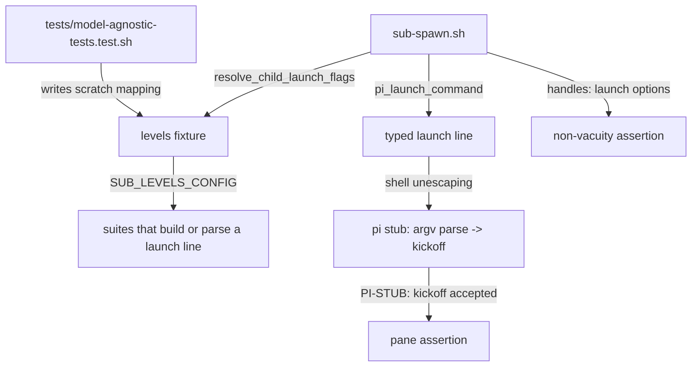

# Design: model-agnostic spawn/launch tests

## Summary

`config.json` is the owner's hand-edited single source of truth for the
level → model and level → thinking mappings. A test that names a model id or
a thinking level — or that fails when the mapping changes — is a bug in the
test (user directive, 2026-10-18). This change fixes the one harness that was
coupled, turns the fix into a guard (the same spawn path is exercised with an
arbitrary, repository-external mapping), and audits the rest of the suite.

No production code changes: `scripts/*` and the shipped `config.json` are
untouched. The defect lives in a test harness, so the harness and its guard
are the whole artifact.

## The defect

`specs/fix-worktree-trust-prompt/test_spawn_trust.sh` runs the real
`scripts/sub-spawn.sh` in a sandbox and asserts (its `[REQ-3]`) that the
child pi accepted the kickoff instead of stranding it. The sandbox replaces
pi with a stub, and the stub parsed its own argv naively:

```bash
--approve | -a) approved=1 ;;
-n | --name)   idx=$((idx + 1)) ;;   # only -n skips its value
-*) ;;
*) [ -z "$kickoff" ] && kickoff=$arg ;;
```

The real launch line carries the resolved level mapping
(`--model <id> --thinking <level>`, from `config.json`), so the stub took
`--model`'s **value** as the kickoff:

```
PI-STUB: kickoff accepted: opencode-zen-free/space-bunny-free
```

The scenario then failed — or, had the shipped mapping happened to start with
`Read the task brief at`, would have passed for the wrong reason. The
assertion's *spirit* is right and stays: the kickoff must be accepted, not
stranded. Only the harness was broken.

## The fix

**`scripts`-free, in the stub:** parse argv the way pi does. A table of the
options that take a value (`--provider --model --api-key --system-prompt
--append-system-prompt --mode --session --session-id --session-dir --fork
--name --models --tools --exclude-tools --thinking --extension --skill
--prompt-template --theme --use-theme --export --tui-mode` and the short
`-n -e -t -xt`, plus `--opt=value` inline forms and a `--` separator) has
its value skipped; the first remaining positional is the kickoff. The stub
receives the argv the *shell* built, so the value of `--model` arrives
unescaped and whole — including a model id that contains a space.

**The guard:** the harness now runs the spawn path **twice**, with two level
mappings, and the same scenarios against each:

| pass | `SUB_LEVELS_CONFIG` | task | asserts |
|---|---|---|---|
| shipped | unset → the repository's own `config.json` | `test-trust-prompt` | the trust scenarios, and the kickoff accepted (this is `[REQ-2]` of the new feature) |
| mutated | a scratch fixture mapping `standard` to a made-up model id (containing a space) and an unknown thinking level | `test-trust-mapping` | the same trust scenarios, plus the kickoff accepted, plus **non-vacuity**: the resolved launch options printed by `sub-spawn.sh` carry that made-up id and level |

The non-vacuity assertion matters: without it the mutated pass could pass for
the same wrong reason as before. Both passes clear `SUB_LEVEL` / `SUB_MODEL` /
`SUB_THINKING` / `SUB_LEVELS_CONFIG` from the ambient environment, so an
exported variable in the developer's shell can never decide what either pass
resolves.

**The stub self-check** (`[REQ-1]`): before spawning anything, the harness
runs its own pi stub with a synthetic launch line whose `--model` value is a
made-up id with a space, and requires the stub to report the positional
message as the kickoff. That pins the parsing bug where it lives, without
depending on the spawn path or on `config.json`.

## Audit — model coupling in the rest of the suite

| Suite | Verdict |
|---|---|
| `specs/fix-worktree-trust-prompt/test_spawn_trust.sh` | **Coupled — fixed.** The stub's kickoff parsing depended on what `config.json` happened to name; the pass was accidental. Both passes now explicit. |
| `tests/task-levels.test.sh` | **Mostly fixture-local.** `LEVELS_FIXTURE` drives every resolver assertion; the launch-line and `-e` tests use synthetic values (`a/b`, `xhigh`, `fixture/*`). One residual leak: `[REQ-6]` called the resolver with no `SUB_LEVELS_CONFIG`, so its "unknown level" warning was produced by the **shipped** mapping. Now driven by the fixture. `t_req8`'s provider/model strings live in the test's own scratch `settings.json` — an input fixture, not the shipped config. |
| `tests/free-limit-fallback.test.sh` | **Fixture-local.** `setup()` writes `$SB/fixture-config.json`, exports `SUB_LEVELS_CONFIG` at it and clears `SUB_FALLBACK_*`; every `/model <id>`, footer and thinking assertion resolves against that fixture. The `opencode-*` strings are the test's own fixture values. |
| `tests/launch-confirm.test.sh`, `tests/spawn-base-fallback.test.sh` | **Model-agnostic.** Fake panes record the typed line verbatim; the assertions read the kickoff and the launch command's shape (`pi -n demo`, the base branch in the kickoff), never a model id. |
| `tests/sub-common.test.sh` | **Not coupled, but unrepresentative.** `LAUNCH_LINE` is a hand-written launch line with *no* option words, while every real launch line carries `--model`/`--thinking`. The send-confirmation rule therefore never saw one. Neutral fixture option words were added so the fixture matches the shape `pi_launch_command` produces — an input fixture, so no shipped value is asserted. |
| `tests/test-mu.sh`, `tests/install.test.sh`, `tests/helpers-base-fallback.test.sh`, `tests/test-start-main.sh`, `tests/lavish-wake.test.sh` | **No model coupling.** `test-mu.sh`'s `--model 'name with spaces'` is its own argument to `mu`, with a `pi` stub that only logs argv. |

New guard suite `tests/model-agnostic-tests.test.sh`:
- `[REQ-4]` re-runs every suite that builds or parses a child launch line
  (`task-levels`, `launch-confirm`, `spawn-base-fallback`, `free-limit-fallback`,
  `sub-common`) plus the trust harness with `SUB_LEVELS_CONFIG` pointed at a
  scratch mapping naming a model id that exists nowhere in the repository —
  the guard, demonstrated rather than claimed — and fails if any of them goes
  red. The nested runs also clear `SUB_*_UNDER_TEST`, so an ambient override
  cannot point a suite somewhere else.
- `[REQ-4]` also carries a **canary**: under the mutated mapping
  `resolve_child_launch_flags` must return the mutated words, and without it
  must return something different. Without the canary the guard would be green
  for a mapping nothing reads.
- `[REQ-4]` asserts that id is written in no other file of the working tree,
  so the mutation cannot quietly become another coupling.
- `tests/free-limit-fallback.test.sh`'s fixture ids were renamed
  (`fixture-provider/recovery-model`, and its prefix-colliding free twin
  `fixture-free-provider/recovery-model-free`). They already came from the
  suite's own fixture config, but they were spelled like the shipped values —
  so a fixture that stopped being wired up would have gone unnoticed instead
  of failing. The prefix-collision regression keeps working: the free id still
  *contains* the fallback id.

## [REQ-n] traceability

| Scenario | Test |
|---|---|
| `[REQ-1]` identify the positional kickoff whatever options carry | `specs/fix-worktree-trust-prompt/test_spawn_trust.sh`, the stub self-check |
| `[REQ-2]` accept the kickoff under the shipped mapping | `specs/fix-worktree-trust-prompt/test_spawn_trust.sh`, the shipped-config pass (its own `[REQ-3]`) |
| `[REQ-3]` accept the kickoff under an arbitrary mapping | `specs/fix-worktree-trust-prompt/test_spawn_trust.sh`, the mutated-config pass (`Carry the mutated mapping onto the child's launch line` plus the three trust scenarios) |
| `[REQ-4]` launch-line suites stay green under a mutated mapping | `tests/model-agnostic-tests.test.sh` (`[REQ-4]`, three cases: the suites, the canary, the leak check) |
| `[REQ-5]` changed scripts shellcheck- and `bash -n`-clean | `tests/model-agnostic-tests.test.sh`, `specs/fix-worktree-trust-prompt/test_spawn_trust.sh` (its `supp_lint`) |

The trust harness keeps its own `[REQ-1]`…`[REQ-3]` labels for
`specs/fix-worktree-trust-prompt.feature`; the new feature's scenarios are
carried by the same file because it is the only end-to-end harness with a real
pi stub, and are named by their scenario text. No existing label was renumbered.

## Data flow



## Plan

1. Rewrite the pi stub's argv parsing (value-taking option table, `--opt=value`,
   `--`), keeping the trust behaviour byte-for-byte.
2. Add the stub self-check and the mutated-mapping fixture to the harness;
   run the spawn twice (shipped, mutated) with the scenarios against each.
3. Point `tests/task-levels.test.sh`'s unknown-level case at its fixture.
4. Give `tests/sub-common.test.sh`'s `LAUNCH_LINE` neutral option words.
5. Add `tests/model-agnostic-tests.test.sh` (`[REQ-4]`, `[REQ-5]`).
6. Verify: full suite, full suite under a mutated mapping, `shellcheck`,
   `bash -n`.

## Verification

1. `specs/fix-worktree-trust-prompt/test_spawn_trust.sh` — green, with both
   the shipped and the mutated mapping reported separately.
2. `for t in tests/*.test.sh tests/test-*.sh; do bash "$t"; done` — every
   suite exits 0.
3. The same loop with `SUB_LEVELS_CONFIG` pointed at a mapping naming a model
   id that exists nowhere in the repository — every suite exits 0. This is also
   asserted by `[REQ-4]`, so it cannot rot.
4. `shellcheck -S warning` and `bash -n` clean on every changed script.

## Strengths / Weaknesses

- **Strengths**: the defect's *cause* is pinned by a self-check that runs
  without the spawn path, the *effect* is guarded by a mutated mapping whose
  non-vacuity is asserted twice (the handles echo and the typed launch line),
  and the whole rule is enforced at suite level rather than by review.
- **Weaknesses**: `[REQ-4]` re-runs six whole suites (~50 s) — the price of
  proving the invariant end to end rather than by inspection, and it re-runs
  suites that are individually already green. It is a suite-running test, so
  its failures are about *other* tests; the summary names the suite and prints
  its output so that stays diagnosable. The repository-external model id is
  pinned by the working-tree scan, which would also object if someone copied it
  into a comment — an acceptable cost of making "exists nowhere else" a
  mechanical property.

## Code audit (independent pass, post-implementation)

Audited from disk (feature file + changed sources, design doc excluded), with
the conversational rationale set aside. Findings and their disposition:

- **Overview**: no production code changed; the artifact is a set of test
  harnesses, so the deletion test largely applies. The seam is right — each
  harness still crosses the same interface as before (the stubbed pi command
  line, `resolve_child_launch_flags`, `sub-spawn.sh`), and the change *adds* a
  seam that did not exist: the level mapping is now an explicit, per-pass
  input of the end-to-end harness instead of an ambient repository file.
- **Strong — the guard could not fail.** The mutation was pointed at suites
  that already ignore it (their own fixtures, or no level resolution at all),
  so `[REQ-4]` was green by construction. **Fixed**: the canary
  (`[REQ-4]`, first half) asserts the mutated mapping really drives
  `resolve_child_launch_flags`, and a deliberate regression (removing
  `SUB_LEVELS_CONFIG` from one `task-levels` case) was run to confirm the
  guard does go red.
- **Strong — `[REQ-1]`…`[REQ-3]` lived in a file no runner executes.** Nothing
  in the repository runs `specs/*/test_*.sh` (the documented loop is
  `tests/*.test.sh`). **Fixed**: the trust harness is now part of the guard's
  list, so a suite that runs the suites runs it too — and its immunity to an
  ambient mapping is asserted there.
- **Strong — the non-vacuity check sat on the wrong surface.** It read
  `sub-spawn.sh`'s handles echo (`CHILD_LAUNCH_FLAGS`), which stays green even
  if `pi_launch_command` dropped the option words. **Fixed**: the check now
  also requires the mutated id on the line the shell actually typed, matched
  against the pane with whitespace and `printf %q` backslashes stripped so a
  wrapped launch line still matches.
- **Worth exploring — fixture ids spelled like shipped values.** See above;
  the fallback suite's ids are now unmistakably fixture-local.
- **Considered and deliberately not done**: sharing one mutated-mapping
  fixture between the two harnesses (they would then share one
  single-point-of-edit, and a leak-check would have to cover both files; the
  duplication is five lines each); deriving the suite list by grepping instead
  of naming it (an explicit list says what it covers); dropping the
  duplicated trust scenarios from the mutated pass (they are the end-to-end
  proof that an odd mapping does not disturb the trust resolution or the
  shell quoting).