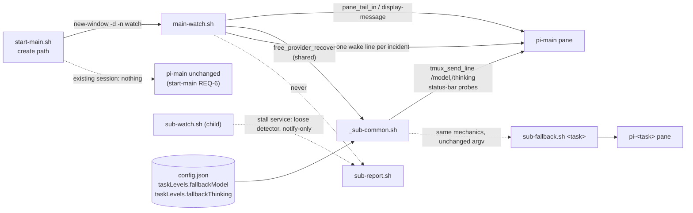
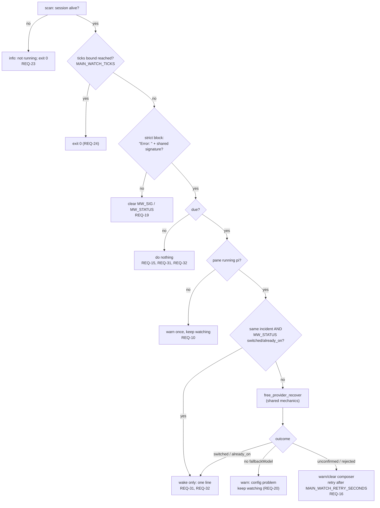

# Design: watch and recover the orchestrator's own pi session

## Abstract

Nothing watched the orchestrator. The child watcher arms one `watch` window per
child and its stall service is deliberately notify-only; `sub-fallback.sh`
recovers a *child*. A free-provider failure in `pi-main` therefore wedges the
whole pattern: the session stops answering, children keep working, and no child
notice is ever acted on again.

This change adds three things and moves one:

1. [`scripts/main-watch.sh`](file://scripts/main-watch.sh) **(new)** — one
   single-purpose watcher process for the orchestrator's own session, armed by
   `start-main.sh` in exactly ONE detached extra window named `watch` of that
   session and handed pi's window index (`main-watch.sh <session> <window>`).
   It scans its session's **pi window** with a **strict** variant of the shared
   free-provider vocabulary (only pi's own `Error: ` render counts), applies the
   **shared** `sub-fallback.sh` recovery rules (never re-implemented), and types
   exactly one wake line per incident so the interrupted turn resumes.
2. [`scripts/_sub-common.sh`](file://scripts/_sub-common.sh) **(modified)** —
   the recovery mechanics (switch → status-bar confirm → thinking) and the pane
   probes learn a *session* target; the task-targeted functions that still have
   child callers (`pane_tail`, `pane_has_free_limit_error`) stay as thin
   wrappers, so those child call sites are byte-identical, and the rest are
   `_in`-only. The strict
   detector and the incident/dedupe logic stay in the watcher (they are the
   watcher's business, not the recovery's).
3. [`scripts/sub-fallback.sh`](file://scripts/sub-fallback.sh) **(modified)** —
   delegates the switch/confirm/thinking sequence to those shared functions
   while its argv, stdout, stderr wording and exit codes for children stay
   identical.
4. [`scripts/start-main.sh`](file://scripts/start-main.sh) **(modified)** —
   arms the window on the *creation* path only, hands the watcher the pi window
   index it resolved before arming, honours `START_MAIN_NO_WATCH=1`, warns
   (never fails) when the window cannot be created, and reports the watcher
   state. An existing session gains no window (start-main [REQ-6]).

`config.json` is untouched and nothing here names a model id or a thinking
level: the values come from `taskLevels.fallbackModel` /
`taskLevels.fallbackThinking` (env overrides as `sub-fallback.sh` already has
them), and the knobs are pure timing/arming.

## Stated / deduced / assumed

- **Stated** (feature file, 33 scenarios: [REQ-1]…[REQ-27], [REQ-31],
  [REQ-32], [REQ-33]…[REQ-36] — there is no [REQ-28]…[REQ-30]): one extra
  `watch` window at
  startup in the session named by `MAIN_SESSION`; strict detection; shared
  recovery rules; one wake after a confirmed switch; one switch per incident;
  retry an unconfirmed switch, re-wake only after the rewake interval; config
  problems only warn; the watcher dies with its session; existing session
  untouched; child stall service and `sub-fallback.sh` for children unchanged;
  shellcheck-clean.
- **Deduced**: the child-scoped engine (`_sub-watch.sh`) owns a child's lease,
  worktree, PR and branch, so a `main` service there would drag all of that
  into the orchestrator — the orchestrator watcher is a sibling of
  `sub-lavish-watch.sh` / `sub-pr-watch.sh` in *shape* (thin `main()` entry
  point, `BASH_SOURCE` guard, env knobs) and a separate file. The recovery must
  not be duplicated, so the *mechanics* move down to `_sub-common.sh` and the
  *policy* (which failure counts, when an incident starts/ends) stays at each
  caller: the child's policy is the loose detector, the watcher's is the strict
  one.
- **Assumed**: pi renders a provider error as a block whose first line starts
  with `Error: ` and whose wrapped continuation lines carry the JSON type; the
  status bar (last non-empty pane line) shows `(<provider>) <id> • <level>` in
  any session, main included. Both are what the existing probes already rely on.
- **Non-goal carried from the feature**: a structured detector over the session
  JSONL's last `stopReason: "error"` — a documented follow-up, not this change.

## Entities and seams

### `scripts/main-watch.sh` — the orchestrator watcher (new, single purpose)

`main-watch.sh [session] [window]` (default session `$MAIN_SESSION`; no
window default). One interface for the caller (`start-main.sh` passes the
session it just created and pi's window index, resolved before it arms this
watcher); everything below is implementation:

| Function | Role |
|---|---|
| `mw_init` | Resolve the session and the optional window argument, pin the *pane/send* target to pi's **verified window** (`=$SESS:<index>`) and build the existence target `=$SESS` (the exact-name forms `sub-report.sh` uses), validate the knob family (and refuse a non-numeric window argument on the usage line), seed state. |
| `mw_window_exists` | `tmux display-message -p -t "=$SESS:<index>" '#{window_index}'` → the reported index **equals** the requested one. The only proof a pin is real: tmux resolves a missing index — and `=SESS:0` on a base-index-1 server — to the session's *selected* window, and `display-message` succeeds either way. |
| `mw_set_pin` | Set `MW_TARGET="=$SESS:<index>"` for a verified index; otherwise the documented last resort `="$SESS:"` (session-level). An unverified index is never pinned. |
| `mw_resolve_window` | `tmux list-windows -t "=$SESS" -F '#{window_index} #{pane_current_command}'` → the first *pi-like* window's index (per `mw_command_is_pi`), else the **first listed** index — never a literal, because index `0` does not exist on a base-index-1 server and a knock-on fallback to it re-creates the blindness. |
| `mw_pin_target` | The window argument `start-main.sh` armed with, **when it verifies** (`mw_window_exists`); otherwise `mw_set_pin "$(mw_resolve_window)"`. A pinned window cannot follow the operator's selection, unlike `=$SESS:` — which would capture the `watch` window's own pane. |
| `mw_command_is_pi` | A pane command is pi-like when it is non-empty and **not** on the deny-list `sh\|bash\|zsh\|fish\|dash\|ksh\|tcsh\|csh\|nu\|elvish\|xonsh\|tmux\|screen` (case-insensitive). Deliberately not `== pi`: pi is a launcher symlink on some hosts and a `node`/`bun`-exec'd process on others, where an `== pi` test makes the watcher inert. |
| `mw_follow_pi_pane` | Re-pin once from `mw_resolve_window` (the same resolver) when the pinned pane is not pi-like, before each scan, so a session that runs pi in another window is followed; `MW_WARNED_NOT_PI` is never touched here, so a session with no pi-like window still warns once per incident, not once per scan. |
| `mw_session_alive` | `tmux has-session -t "=$SESS"` (REQ-23). |
| `mw_pane_is_pi` | `tmux display-message -p -t "$MW_TARGET" '#{pane_current_command}'` → `mw_command_is_pi` — the guard that never types into a shell pane (REQ-10), same kind of probe `lavish_wake_child` uses, widened so a pi that is not literally named `pi` is still recognised. |
| `mw_scan_strict` | The strict detector (below): sets `MW_KIND` and `MW_SIG`, or clears them (REQ-3…REQ-7). |
| `mw_new_epoch` | Monotonic epoch for the wake marker, the `_PR_LAST_EPOCH` / `new_stall_epoch` rule (REQ-15, REQ-32). |
| `mw_compose_wake` | The one wake line (below) (REQ-17, REQ-31). |
| `mw_wake` | Verified send of that line to `$MW_TARGET`; 0 only when confirmed. |
| `mw_recover` | One recovery attempt: resolve `fallbackModel` / `fallbackThinking`, call the shared `free_provider_recover`, translate its outcome code into `MW_STATUS` and the operator messages, and wake iff the outcome is switch-confirmed or already-on. |
| `mw_tick` | One scan: follow pi's window (re-pin from the resolver when the pinned pane is not pi-like) → detect → reset on a clean pane → due check (below) → `mw_recover` / wake-only. |
| `mw_loop` | The single-clock loop: session alive? → scan → `MAIN_WATCH_TICKS` bound → sleep `MAIN_WATCH_INTERVAL`. |

**State** (module globals, mirroring the child services' idiom):

| Variable | Meaning | Reset |
|---|---|---|
| `MW_SIG` | identity of the incident being handled: the kind plus the flattened matched error block | cleared when no strict block matches (REQ-19) |
| `MW_STATUS` | `none` \| `switched` \| `already_on` \| `unconfirmed` \| `no_fallback` | `none` |
| `MW_LAST_ATTEMPT` | epoch of the last attempt | `0` |
| `MW_WARNED_CONFIG` | warn-once flag for a config problem | `0` |
| `MW_EPOCH` | last wake epoch (monotonic source) | — |
| `MW_SCANS` | completed scans, for `MAIN_WATCH_TICKS` | `0` |

**Due rule** (the `stall_tick` / `lavish_tick` idiom, one table):

```
sig != MW_SIG                     -> due after MAIN_WATCH_RETRY_SECONDS  (new incident)
sig == MW_SIG, MW_STATUS in
        {switched, already_on}    -> due after MAIN_WATCH_REWAKE_SECONDS (re-wake only)
sig == MW_SIG, anything else      -> due after MAIN_WATCH_RETRY_SECONDS  (retry the switch)
due && sig == MW_SIG && MW_STATUS in {switched, already_on}
                                  -> wake only, never /model   (REQ-31, REQ-32)
due otherwise                     -> mw_recover, then wake iff switched|already_on
```

The last table row is gated on the incident identity, not on `MW_STATUS`
alone: a `switched` left over from an *earlier* incident must never turn a
*new* incident into a wake-only, or the new failure's model would never be
switched. That happens when the old banner scrolls out of the visible window
and a different error render takes its place between two scans, with no
error-free scan in between (REQ-35).

`MW_LAST_ATTEMPT` starts at `0`, so the first scan of a visible failure is
immediately due. `MW_SIG` is only recorded once an outcome is *completed*
(`switched`/`already_on`); an unconfirmed switch or a config problem leaves it
empty, so the retry interval governs and the switch is retried (REQ-16) — this
is exactly how the child services keep an unconfirmed notice retried.

**Loop** (one clock, no per-service table needed):

```
loop:
  session alive?                  -> no: info "watched session … is not running"; exit 0   (REQ-23)
  MW_SCANS >= MAIN_WATCH_TICKS?   -> (only when > 0) exit 0                                (REQ-24)
  mw_tick ; MW_SCANS++
  sleep MAIN_WATCH_INTERVAL (floored at 0.05 s)
```

A recovery attempt may block the loop for the status-bar poll
(`FALLBACK_PROBE_ATTEMPTS × FALLBACK_PROBE_DELAY`, the existing test-first
hooks); the next scan starts after the attempt ends, so scans never overlap and
never pile up.

### The shared recovery seam in `scripts/_sub-common.sh`

**Session-targeted probes** (new), with the task-targeted functions that
still have a child caller kept as one-line wrappers over `session_of` — child
behaviour stays byte-identical (REQ-25, REQ-26). The other four are `_in`-only:
their only child callers were inside the recovery block that moved into
`free_provider_recover`, so a task wrapper would have had no caller at all
(removed in the audit pass):

| New (session target) | Wrapper kept (task) |
|---|---|
| `pane_tail_in <session> <lines>` | `pane_tail <task> <lines>` |
| `pane_last_line_in <session>` | — (`pane_last_line` had no caller left) |
| `pane_has_free_limit_error_in <session> [lines]` | `pane_has_free_limit_error <task> [lines]` |
| `pane_thinking_level_rejected_in <session> [lines]` | — (same) |
| `pane_shows_model_in <session> <model>` | — (same) |
| `pane_shows_thinking_in <session> <level>` | — (same) |

`_FALLBACK_ERROR_RE` and `_FALLBACK_THINKING_ERROR_RE` stay the one signature
vocabulary every caller shares ([REQ-6]).

**The recovery mechanics** (new, moved verbatim out of `sub-fallback.sh`):

| Function | Contract |
|---|---|
| `clear_composer <target>` | `send-keys <target> C-u` (REQ-16) |
| `confirm_model_in <target> <model>` | Poll the status bar, nudging bare Enters while the model id is missing (REQ-8, REQ-12) |
| `confirm_thinking_in <target> <thinking> <lines>` | 0 seen, 2 rejected (`Error: Unknown thinking level`), 1 unconfirmed (REQ-13, REQ-14) |
| `free_provider_recover <target> <model> <thinking> <lines>` | Already-on guard → verified `/model` → `confirm_model_in` → `/thinking` only when the bar is not already there → `confirm_thinking_in`. Prints the same informational lines the child prints today; clears the composer on every unconfirmed/rejected path. Returns an outcome code. |
| `free_provider_failure_message <code> <target> <model> [role] [thinking]` | The one place the failure sentences live, so the child's stderr and the watcher's warning cannot drift (REQ-16, REQ-20, REQ-26). The thinking level is an argument, not state: a caller formats a sentence from the level it passed to `free_provider_recover`, so it never depends on which recovery ran last. |

Outcome codes of `free_provider_recover`: `0` switched (thinking set / already
in effect / nothing configured), `5` already on the fallback (nothing sent),
`1` model switch unconfirmed, `2` switch confirmed but `/thinking` rejected,
`3` no `fallbackModel` configured (nothing sent), `4` switch confirmed but
`/thinking` unconfirmed.

**`sub-fallback.sh` after the change** (identical observable behaviour,
REQ-26):

```
session gate (die "child session … is not running")
loose detect gate  -> info "no free-provider failure (…) — no model switch performed"; exit 0
MODEL/THINKING     -> resolve_fallback_model / resolve_fallback_thinking
rc=free_provider_recover "$SESS" "$MODEL" "$THINKING" "$FALLBACK_SCAN_LINES"
case rc in
  0|5) exit 0                       # 5 already printed "already on fallback …"
  2|4) warn "$(free_provider_failure_message "$rc" "$SESS" "$MODEL" child "$THINKING")" ;;
  3)   die  "$(free_provider_failure_message 3 "$SESS" "$MODEL")" ;;
  *)   die  "$(free_provider_failure_message 1 "$SESS" "$MODEL")" ;;
esac
```

The loose detect gate, its exact wording, the `FALLBACK_*` knobs and the
"already on fallback" no-op all stay in the child's own file: the *policy*
remains per-caller, only the mechanics are shared.

### `scripts/start-main.sh` — arming (creation path only)

After the verified launcher send, on the path where the session was just
created (an existing session returns through `finish` before this block, so
REQ-2 and start-main [REQ-6] hold):

```
PI_WIN = tmux display-message -p -t "=$SESS:" '#{window_index}'   # before arming:
                                                                 # the session has
                                                                 # exactly one window
START_MAIN_NO_WATCH=1            -> WATCH_STATE="disabled (START_MAIN_NO_WATCH=1)"
tmux new-window -d -t "=$SESS:" -n watch -c "$ROOT" \
     "exec <SCRIPT_DIR>/main-watch.sh <SESS> <PI_WIN>"     # window arg omitted if empty
   success                       -> WATCH_STATE="watch window in $SESS (orchestrator stall recovery)"
   failure                       -> WATCH_STATE="unavailable"; warn "… could not be armed … only automatic stall watching is missing"
```

- The window index is resolved **before** the `watch` window exists, because at
  that moment the just-created session has exactly one window — the pi one — so
  `=SESS:` is unambiguous. It is passed to the watcher, which verifies it
  before pinning. A literal index cannot substitute: on a base-index-1 server
  (this host sets `base-index 1`) index `0` does not exist and tmux resolves it
  to the session's *selected* window — which becomes the watcher's own window
  the moment the `watch` window is armed, exactly the blindness REQ-3 forbids.

- `-d` is load-bearing: it keeps the pi window current, so the existing suite's
  `show-options -w -v -t "=pi-main:"` / `pane_pid` / `pane_cwd` assertions
  still address the pi window (REQ-1's "first window still runs pi", and the
  start-main layout contract).
- `-c "$ROOT"` roots the watcher in the same checkout, like the session.
- The state string is appended to the existing start echo, so
  `--detach` output reports armed / disabled / unavailable (REQ-1, REQ-21,
  REQ-22) without changing any line the current suite greps.

### The strict detector (REQ-3…REQ-7)

Scan the bounded tail (`pane_tail_in "$MW_TARGET" "$MAIN_WATCH_SCAN_LINES"`,
default 50) line by line, in pane order. A line qualifies as a **banner** when
its leading-whitespace-trimmed text starts with `Error: ` (the same trim idiom
`_pi_pending_row` uses). For a banner, test:

1. the banner line itself against `_FALLBACK_ERROR_RE`; then
2. its following continuation lines, one at a time, bounded by
   `_MAIN_ERR_CONT_LINES` (4) and stopping at the first blank line or at a line
   that is itself an `Error: ` banner (REQ-6, REQ-7).

Each candidate line is matched on its own, so `_FALLBACK_ERROR_RE` keeps its
documented line-scoped meaning (`429 … rate-limit wording` never assembles
across lines). The first hit fixes `MW_KIND` (same three-way classification the
stall service uses) and `MW_SIG` (kind + flattened matched block).

Why nothing else can match:

- A signature quoted in analysis prose or tool output is on a line whose
  trimmed text does not start with `Error: ` — no banner, no match (REQ-4).
- A delivered `STUCK: free-provider failure in the child pane (…)` notice
  reaches the orchestrator as `[<task>] STUCK: …` (`sub-report.sh` prefixes the
  task). Its trimmed text starts with `[`, never `Error: `, so the watcher's own
  notification traffic can never look like an incident (REQ-5).
- pi's `Error: Unknown thinking level` render is a banner but carries no entry
  of `_FALLBACK_ERROR_RE` — no match.
- A pane with ordinary transcript output yields no banner — no keys, no
  commands (REQ-9); a shell pane is additionally blocked by `mw_pane_is_pi`
  (REQ-10).
- The child's stall service keeps the **loose** detector
  (`pane_has_free_limit_error`) untouched (REQ-25).

### The wake line (REQ-15, REQ-17, REQ-31, REQ-32)

```
Resume the interrupted turn: the free-provider failure that stopped it is
recovered. Do not repeat work already done — continue from where the turn
stopped. [main-watch <epoch>]
```

(one physical line, one verified send, no model or level named). Composition
rules:

- **Unique per attempt.** `mw_new_epoch` keeps `<epoch>` non-decreasing-strict
  (`date +%s`, bumped when it is not greater than the previous one), exactly as
  the `[pr-watch …]` / `[stall-watch …]` markers do. `tmux_send_line` refuses to
  trust a probe that is already visible, so a re-wake must not reuse the earlier
  text; the epoch also sits inside the helper's 60-character tail probe, so the
  confirmation is about *this* copy.
- **Confirmed, never assumed.** `mw_wake` returns 0 only when
  `tmux_send_line "$MW_TARGET" "$msg"` confirmed submission (transcript or
  pending display). An unconfirmed wake leaves `MW_STATUS` unchanged, so the
  due rule retries it after the retry interval.
- **Exactly one per incident.** A completed attempt records `MW_SIG` and
  `MW_STATUS`; the next scan of the same visible failure is not due, so no
  `/model`, no `/thinking` and no wake are sent before `MAIN_WATCH_REWAKE_SECONDS`
  (REQ-15). After it, exactly one further wake, and never a `/model` for the
  same incident (REQ-32). A wake is only ever typed when the switch was
  confirmed or the session was already on the fallback (REQ-17, REQ-31); an
  unconfirmed switch produces no wake.
- **Never reports to itself.** The send is a direct `tmux_send_line`, never
  `sub-report.sh`; no keys go anywhere but `$MW_TARGET` (REQ-18).

## Behaviour and data flow



Pin resolution (one table, all paths end in a *verified* window):

| Case | Pin |
|---|---|
| window argument from `start-main.sh`, verifies | `=$SESS:<arg>` |
| window argument missing or does not verify | resolve from `list-windows`: first pi-like window, else the first listed index; pin it if it verifies |
| no pi-like window | the first **listed** index (never a literal, never `0`) |
| nothing verifies at all | `=$SESS:` — documented last resort; the pi-like guard still blocks typing into a shell |
| pinned pane stops being pi-like on a later scan | re-resolve from `list-windows`, same rule, `MW_WARNED_NOT_PI` untouched |

One scan:



## Plan

1. `_sub-common.sh`: rename the pane probes to session-targeted `*_in`
   functions, add the task-targeted wrappers, and move `clear_composer`,
   `confirm_model_in`, `confirm_thinking_in`, `free_provider_recover`,
   `free_provider_failure_message` down from `sub-fallback.sh` (REQ-25,
   REQ-26).
2. `sub-fallback.sh`: keep the session gate, the loose detect gate and the
   `FALLBACK_*` knobs; replace the switch/confirm/thinking block with one
   `free_provider_recover` call and a `case` that reproduces today's messages
   and exit codes (REQ-26).
3. `main-watch.sh`: knobs, state, window-argument + verified pin, pi-like
   oracle, strict detector, due rule, wake line, loop
   (REQ-1…REQ-24, REQ-31, REQ-32, REQ-33…REQ-36).
4. `start-main.sh`: resolve pi's window index, arm one detached `watch` window
   on the creation path passing it, honour `START_MAIN_NO_WATCH`, warn on
   failure, report the state (REQ-1, REQ-2, REQ-21, REQ-22).
5. `AGENTS.md`: helper-table row for `main-watch.sh` and the watcher sentence
   on the `start-main.sh` row; a new "Orchestrator watcher" subsection (knobs,
   strict detection, shared recovery, one wake, existing session untouched);
   `sub-fallback.sh` text notes it still recovers children only (REQ-25,
   REQ-26).
6. Verify: `bash -n` + `shellcheck -x -P SCRIPTDIR` on the three touched
   scripts (REQ-27), then every existing suite (below).

## Proposed changes (files/modules)

| File | Change | Serves |
|---|---|---|
| `scripts/main-watch.sh` **(new)** | Single-purpose orchestrator watcher: `mw_init`, `mw_session_alive`, `mw_window_exists`, `mw_set_pin`, `mw_resolve_window`, `mw_pin_target`, `mw_command_is_pi`, `mw_pane_is_pi`, `mw_follow_pi_pane`, `mw_scan_strict`, `mw_new_epoch`, `mw_compose_wake`, `mw_wake`, `mw_recover`, `mw_tick`, `mw_loop`; argv `<session> [window]`; knobs `MAIN_WATCH_INTERVAL` (30), `MAIN_WATCH_RETRY_SECONDS` (30), `MAIN_WATCH_REWAKE_SECONDS` (900), `MAIN_WATCH_SCAN_LINES` (50), `MAIN_WATCH_TICKS` (0 = unbounded) | [REQ-1], [REQ-3]–[REQ-24], [REQ-27], [REQ-31]–[REQ-36] |
| `scripts/_sub-common.sh` **(modified)** | `pane_tail_in`, `pane_last_line_in`, `pane_has_free_limit_error_in`, `pane_thinking_level_rejected_in`, `pane_shows_model_in`, `pane_shows_thinking_in` + the two wrappers with live child callers; `clear_composer`, `confirm_model_in`, `confirm_thinking_in`, `free_provider_recover`, `free_provider_failure_message` | [REQ-3], [REQ-6], [REQ-8], [REQ-11]–[REQ-14], [REQ-16], [REQ-20], [REQ-25], [REQ-26], [REQ-27] |
| `scripts/sub-fallback.sh` **(modified)** | Delegates the switch/confirm/thinking block to `free_provider_recover`; keeps its session gate, loose detect gate, `FALLBACK_*` knobs, messages and exit codes | [REQ-26] |
| `scripts/start-main.sh` **(modified)** | Resolve pi's window index before arming, one detached `watch` window on the creation path passed `<session> <window>`, `START_MAIN_NO_WATCH=1`, warn-not-fail on a refused window, watcher state in the output; existing session untouched | [REQ-1], [REQ-2], [REQ-21], [REQ-22], [REQ-27] |
| `AGENTS.md` **(modified)** | Helper-table row + "Orchestrator watcher" subsection (knobs, strict rule, shared recovery, wake, existing session untouched); no model ids or levels | [REQ-1], [REQ-2], [REQ-21]–[REQ-24], [REQ-31]–[REQ-36] |
| `specs/orchestrator-stall-recovery/orchestrator-stall-recovery.feature` | Amended in the audit pass: [REQ-33] (follow pi's window, not the selection), [REQ-34] (never pin an unverified index), [REQ-35] (a different incident is recovered, not merely woken) — scenarios for behaviour the implementation already owned; [REQ-36] (a launcher/interpreter pi is still pi) | [REQ-33]–[REQ-36] |
| `tests/main-watch.test.sh` **(phase 3, new)** | One test per scenario of the watcher, hermetic fake-tmux + fixture config; the `swap-incident` fake mode stages a new incident with no clean scan between (`REQ-35`) | [REQ-3]–[REQ-20], [REQ-23], [REQ-24], [REQ-31]–[REQ-36] |
| `tests/test-start-main.sh` **(phase 3, extended)** | Window list/count, `START_MAIN_NO_WATCH=1`, refused window, watcher state in the output, existing session gains no window | [REQ-1], [REQ-2], [REQ-21], [REQ-22] |
| `tests/free-limit-fallback.test.sh`, `tests/unified-child-watcher.test.sh` **(phase 3, unchanged behaviour)** | Stay the regression seam for the delegation and the notify-only stall service | [REQ-25], [REQ-26] |
| `config.json` | **Untouched** — `fallbackModel` / `fallbackThinking` are read, not added | [REQ-8], [REQ-13], [REQ-20] |

## What must not change

- **`sub-fallback.sh` for children** — argv, stdout/stderr wording, exit codes,
  `FALLBACK_*` knobs, the loose detect gate, "already on fallback" no-op, the
  loud unconfirmed failure and the config-problem degradation (REQ-26). Its
  suite must pass untouched.
- **The child stall service** — `_sub-watch.sh`'s `stall_*` stay notify-only
  with the loose detector; `_sub-watch.sh`, `sub-watch.sh`, `sub-spawn.sh` and
  `_sub-watch.sh`'s services get no diff (REQ-25).
- **The existing suites** — no assertion may need editing; the start-main
  layout/window assertions must hold with the extra window (hence `-d`).
- **`config.json` and `README.md`** — never touched; no model id or thinking
  level appears in code, docs or tests.

## Knob surface (no values naming a model or level)

| Knob | Default | Serves |
|---|---|---|
| `MAIN_WATCH_INTERVAL` | 30 s | [REQ-3], [REQ-9], [REQ-15] |
| `MAIN_WATCH_RETRY_SECONDS` | 30 s | [REQ-16], [REQ-20] |
| `MAIN_WATCH_REWAKE_SECONDS` | 900 s | [REQ-15], [REQ-32] |
| `MAIN_WATCH_SCAN_LINES` | 50 | [REQ-3], [REQ-7] |
| `MAIN_WATCH_TICKS` | 0 (test bound) | [REQ-24] |
| `START_MAIN_NO_WATCH` | unset | [REQ-21] |
| `SUB_FALLBACK_MODEL` / `SUB_FALLBACK_THINKING` / `SUB_LEVELS_CONFIG` | existing | [REQ-8], [REQ-13], [REQ-20] |
| `FALLBACK_PROBE_*`, `FALLBACK_SEND_ATTEMPTS` | existing | [REQ-8], [REQ-13] |

Knob values are validated once at start (non-negative integer, or a
non-negative decimal for the interval, floored at 0.05 s) and a bad value
`die`s with the knob name — the family's precedent.

## Expected test seams (phase 3)

- **`tests/main-watch.test.sh`** — hermetic, no real tmux: a stateful fake
  `tmux` first on PATH keyed by normalized target: `<window index> <name>`
  windows and a `selected` index (a missing index resolves to the selected
  window, as tmux does — so a `=S:0` pin is visibly *not* the pi window), a
  parameterized `cmd` for the pi window's `#{pane_current_command}` (so `node`
  is covered, not only `pi`), a `pane-watch` for the watch window's own pane, a
  `footer` for the status bar, a `send-keys` log, a `targets` log of every
  addressed target, mode flags for `drop-enter` / `no-apply` /
  `reject-thinking` / `pane-bash` / `relapse`, reusing the
  `tests/free-limit-fallback.test.sh` shape. Window indexes are **1-based**, as
  on this host (`base-index 1`). The fallback pair comes from a
  `SUB_LEVELS_CONFIG` fixture (never the shipped `config.json`; fixtures use
  suite-local ids like the free/fallback pair the existing suites already
  build). `MAIN_WATCH_INTERVAL=0`, `MAIN_WATCH_TICKS=1`, `FALLBACK_PROBE_DELAY=0`
  keep it fast. Pane fixtures: pi's `Error:` render for both kinds, a wrapped
  render, a prose mention, a delivered `[task] STUCK: …` notice, a clean pane, a
  shell pane, and a status bar that extends the fallback id. Pin tests: a
  `node`-commanded pane is still recovered (pinned to the window argument, and
  again from the resolver with no argument), a selected watch window does not
  blind the watcher, and an index that does not verify is never the pin.
- **`tests/test-start-main.sh`** — extend in place (it already runs against an
  isolated tmux server with fake `pi`): assert exactly one extra window named
  `watch` (`list-windows -F '#W'`), the first window still running the fake
  `pi`, `START_MAIN_NO_WATCH=1` adds none, the existing-session path adds none
  and keeps `pane_pid`/`main-pane-width`, and a `tmux` shim placed first on the
  server's pane PATH that exits non-zero for `new-window -n watch` yields
  exit 0 + a warning + the "unavailable" wording.
- **Suites that must stay green**: `tests/free-limit-fallback.test.sh`
  (delegation, REQ-26), `tests/unified-child-watcher.test.sh` (stall service,
  REQ-25), `tests/sub-common.test.sh` (region parser + verified send),
  `tests/test-start-main.sh` (REQ-1/2/21/22), `tests/lavish-wake.test.sh`,
  `tests/pr-action-watch.test.sh` (the `pane_*` wrappers),
  `tests/model-agnostic-tests.test.sh` (it re-runs `free-limit-fallback` and
  `sub-common` under a mutated mapping — the new suite must be model-agnostic
  too), `tests/task-levels.test.sh`, `tests/helpers-base-fallback.test.sh`
  (shellchecks `_sub-common.sh`), `tests/launch-confirm.test.sh`,
  `tests/spawn-base-fallback.test.sh`, `tests/spawn-kickoff-brief.test.sh`,
  `tests/sub-report.test.sh`, `tests/sub-retire.test.sh`,
  `tests/retire-cost-log.test.sh`, `tests/conversation-log.test.sh`,
  `tests/skills-sync.test.sh`, `tests/worktree-setup.test.sh`,
  `tests/install.test.sh`, `tests/test-mu.sh`,
  `tests/rename-mu-commander.test.sh`, `tests/rename-project.test.sh`.

## Documentation touchpoints

- `AGENTS.md` *Helper scripts* table: a `main-watch.sh` row, and the
  `start-main.sh` row gains "arms one `watch` window (`START_MAIN_NO_WATCH=1`
  opts out)".
- `AGENTS.md` *pi sessions* → new "Orchestrator watcher" subsection beside
  "Child watcher": one window in `MAIN_SESSION`, armed only when `start-main.sh`
  creates the session, strict `Error: ` detection, the shared `sub-fallback`
  recovery rules, exactly one wake per incident, `MAIN_WATCH_*` knobs, dies
  with the session, existing session untouched, and "`sub-fallback.sh` still
  recovers children only".
- No model ids and no thinking levels in any doc touchpoint (config.json stays
  the single source of truth).
- Nothing enumerates scripts: there is no script manifest, no `package.json`,
  no Makefile, and neither `install.sh` nor `mu` lists files under `scripts/`
  (`install.sh` mirrors `required-skills/` and links `mu`; `mu` is a standalone
  launcher). The new name needs no registration — only the AGENTS.md rows.

## Best practices taken

- **Deep module at a narrow seam**: `main-watch.sh [session] [window]` hides knob
  validation, strict parsing, incident identity, dedupe, retry/rewake,
  status-bar confirmation and wake composition behind one positional argument;
  `free_provider_recover` hides detect-after-gate → switch → confirm → thinking
  behind four arguments and one outcome code, so the child and the orchestrator
  cannot drift.
- **Reuse over duplication** (REQ-26): the recovery mechanics and the failure
  sentences exist once. The *policy* stays at the callers, which is exactly why
  the child keeps the loose detector and the orchestrator gets the strict one
  without touching the stall service (REQ-25).
- **Replace, don't layer**: the pane probes gain a session target instead of a
  parallel family; only the two wrappers that still have a child caller remain,
  and no caller notices.
- **Structure mirrored from the sibling services**: state/dedupe/rewake and the
  monotonic epoch marker are the `stall_tick` idiom, so the watcher reads like
  the rest of the family; `new-window -d -n watch` and warn-not-fail are
  `sub-spawn.sh`'s arming idiom.
- **Never send speculatively, never claim unconfirmed work**: detection gates
  every send, the status bar is the only confirmation, the composer is cleared
  on any unconfirmed path, and a wake is typed only after a confirmed or
  already-satisfied switch.
- **Model-agnostic and config-content-free**: values come from
  `taskLevels.fallbackModel` / `taskLevels.fallbackThinking` only; no test,
  doc or code names a model id or a level.

## Decision strengths and weaknesses

**Strengths** — one new file with one purpose and one lifecycle (it dies with
the session it watches); the recovery rules have one implementation, so a
future change to the switch/confirm sequence cannot fix children and miss the
orchestrator (or vice versa); the strict detector is separate from the shared
vocabulary, so tightening it cannot loosen the child's stall service; the
existing-session contract is honoured structurally (the arming block sits after
the early return); every failure path is explicit about what was and was not
done; nothing names a model or a level.

**Weaknesses**

1. Detection is still textual and pane-based. A *user turn or agent message*
   whose line begins with `Error: ` next to a signature (e.g. quoting this
   feature) could false-positive; the outcome is a visible `/model` switch and
   one wake, and a follow-up structured detector over the session JSONL's last
   `stopReason: "error"` is the documented next step.
2. The continuation window is bounded (4 lines) and matched line by line, so a
   signature wrapped far from the banner — or a `429` and its rate-limit wording
   split across two lines — is missed. Conservative by design: the single-token
   JSON type names are the real signature.
3. A recovery attempt blocks the scan loop for the status-bar poll, so the
   effective cadence is `interval + attempt`; with the 30 s default and the
   existing probe knobs this can reach ~30 s per confirmed switch. Acceptable
   for a 900 s rewake horizon, but it is not a tick-accurate clock.
4. `main-watch.sh` re-derives its knob validation and floor instead of reusing
   `_sub-watch.sh`'s engine helpers; sharing them would mean the watcher
   sourcing the child engine (lease/worktree concerns) or moving those helpers
   into `_sub-common.sh` — a refactor this feature does not need. Small,
   deliberate duplication.
5. `start-main.sh` cannot tell an armed-but-instantly-dead watcher (missing
   script, unreadable PATH) from a healthy one: `new-window` succeeding is the
   whole check. The window is best-effort by contract, like the child's.
6. `SUB_FALLBACK_MODEL` / `SUB_FALLBACK_THINKING` are now shared by the child
   recovery and the orchestrator recovery: a test that sets them to prove the
   child path also changes the orchestrator's values. The watcher's tests use
   `SUB_LEVELS_CONFIG` fixtures instead, so the suites stay independent.
7. The pi-like test is a deny-list of shells, so a pane running some other
   interactive program (an editor, a pager) counts as pi and may be typed into;
   the alternative — `== pi` — is inert on every install where pi runs as
   `node`/`bun`, which is the worse failure (the whole pattern goes unwatched).
   The deny-list is the one place to tighten if that changes.
8. When no index verifies at all (no window lists, a tmux that answers nothing)
   the pin is the session-level `=$SESS:`, which does follow the operator's
   selection; the shell guard still prevents typing into a non-pi pane, and the
   alternative would be a pin that cannot be proven to exist. Documented last
   resort, not the normal path.

**Found and fixed in the audit pass (phase 4)** — recorded because the first
draft of the due rule above carried the same flaw:

- The wake-only branch keyed on `MW_STATUS` alone, so a `switched` from an
  *earlier* incident could turn a *different* incident into a wake-only when no
  clean scan fell between them (the old banner scrolling out of the visible
  window). Fixed by gating both the due rule and the wake-only branch on the
  incident identity (`MW_FOUND = MW_SIG`); `tests/main-watch.test.sh`
  `[REQ-35]` stages it through the fake tmux's `swap-incident` mode and is
  verified to fail against the identity-blind form.
- Four task-targeted pane wrappers (`pane_last_line`, `pane_shows_model`,
  `pane_shows_thinking`, `pane_thinking_level_rejected`) had no caller left
  after the recovery moved into `_sub-common.sh`; removed, leaving the two with
  live child callers.
- The window-pin and pi-like-oracle machinery had no `[REQ-n]` of its own;
  scenarios [REQ-33] (follow pi's window, never the selection), [REQ-34] (an
  unverified index is never the pin) and [REQ-36] (a launcher- or
  interpreter-run pi is still pi) now own it.

Considered and left as-is: the third copy of the monotonic-epoch idiom (moving
it into `_sub-common.sh` would touch the child watcher's engine, which REQ-25
keeps unchanged); `free_provider_failure_message`'s positional parameters (two
callers, both adjacent to the outcome codes it takes); `start-main.sh` not
probing for `jq` before claiming a window is armed (`jq` is a declared system
dependency, and the child watcher has the same best-effort contract); and
`sub-report.sh` addressing the main session's current window rather than pi's
window (pre-existing: viewer windows already exist in that session).

## Gate

The substantial-change gate **fires** for the original plan: it touches modules
other than the one the feature names (`_sub-common.sh`, `sub-fallback.sh`,
`start-main.sh`, `AGENTS.md`), changes existing seams (the pane probes gain a
session target and the recovery moves out of `sub-fallback.sh`), and adds a new
script. Per the `implement` skill the design stopped there for validation.

This pass is the approved re-entry (window pinning and the pi-like oracle). It
touches only the feature's own modules — `main-watch.sh`, its arming block in
`start-main.sh` (both named by the feature), its test suite and this document —
adds no dependency, migration or configuration surface, and changes no
behaviour no `[REQ-n]` asks for, so the gate does not fire and the plan above is
executed.
