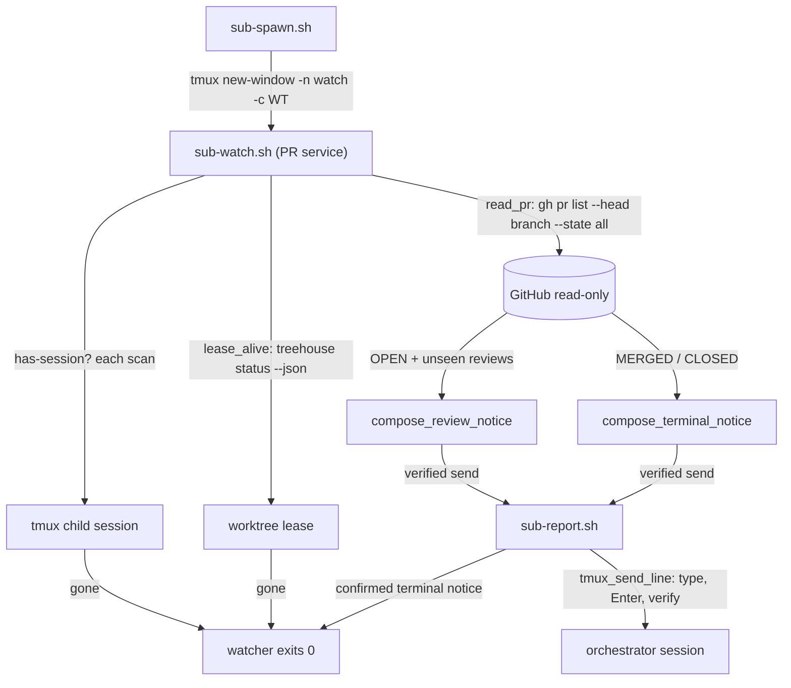

# Design: sub-pr-watch — notify the orchestrator of PR events on a live child

## Abstract

A child opens a pull request for its task branch and then goes idle, so the
GitHub-side events the orchestrator must act on — the PR was **merged**, it
was **closed without merging**, and a **review was submitted** — wait for
someone to check by hand. The fix adds one supervisor-owned watcher per
child, [`scripts/_sub-watch.sh`](file://scripts/_sub-watch.sh) (the PR
service) — since the `unified-child-watcher` change (2026-10-19,
[`specs/unified-child-watcher/`](file://specs/unified-child-watcher/)) that
service runs inside the single `watch` window process
([`scripts/sub-watch.sh`](file://scripts/sub-watch.sh)) together with the
Lavish wake-up and the stall detector;
[`scripts/sub-pr-watch.sh`](file://scripts/sub-pr-watch.sh) remains the
single-service entry point for development and for this suite. The service
polls the branch
read-only with `gh pr list` (never a mutating `gh` command, never a push) and
pushes each event as a one-line notice into the main orchestrator session
through the same verified send every child notice uses
([`scripts/sub-report.sh`](file://scripts/sub-report.sh) → `tmux_send_line`).
It never types into the child's pane, deduplicates submitted reviews, retries
unconfirmed notices, and exits when the child's tmux session or worktree
lease disappears, or right after the confirmed notice for a terminal
(MERGED/CLOSED) state.

**Polling, not webhooks, by design.** A webhook needs a public inbound HTTPS
endpoint, a secret, and a long-lived listener; a tunnel (Tailscale Funnel /
ngrok / cloudflared) needs an installed tunnel client and exposes a local
process to the internet; a GitHub App / relay is a new external service to
deploy and monitor. This machine has none of those, and `gh` is already
authenticated. The events here are human-timescale (a review may wait in the
orchestrator's queue for minutes either way), so a 30-second read-only poll
with zero inbound exposure, zero deployment, and no credentials beyond the
existing `gh` login is the right trade-off. The poller is stateless across
restarts (dedupe is in-memory), which fits the lifecycle: it is armed per
child and dies with the child's tmux session.

## Entities and seams

- [`scripts/_sub-watch.sh`](file://scripts/_sub-watch.sh) **(new)** — the
  PR service and the shared engine:
  - `pr_tick` — one scan; the service seams are:
  - `lease_state <status-json> <task>` + `lease_alive <task> <root>` — a
    **three-valued** lease check (`alive`/`gone`/`unknown`). `wt_for_task`
    collapses a failed `treehouse status` and a missing lease into "empty",
    which must never be read as "the lease was returned": only a successful
    read that lacks the task's lease stops the watcher, a failed read warns
    once and keeps scanning.
  - `read_pr <branch> <root>` — the only GitHub seam: one read-only
    `gh pr list --head <branch> --state all --json …`, normalized by jq to
    compact `{number,url,state,reviews:[{login,state,submittedAt}]}`. Empty
    output means "no PR yet" (keep watching); a non-zero status means
    "unreadable" (warn once, retry). Reviews are filtered to the three
    submitted states the feature names (`APPROVED`,
    `CHANGES_REQUESTED`, `COMMENTED`); `mergedAt` normalizes a MERGED state
    defensively; an open PR is preferred when several match the branch.
  - `review_signature <review-json>` — the dedupe identity
    `login|state|submittedAt`; a later review by the same reviewer has a new
    `submittedAt` and is notified again, only the exact submission is one
    notice.
  - `new_epoch` — sets `PR_WATCH_EPOCH` to a **monotonic** epoch (at least
    the current second, strictly above the previous attempt), so a retried
    notice always ends with a fresh `[pr-watch <epoch>]` marker; the earlier
    copy can never satisfy the verified send's evidence check.
  - `compose_terminal_notice` / `compose_review_notice` — the pure message
    templates; `sub-report.sh` adds the `[<task>] ` prefix.
  - `send_notice` — the only delivery path; returns 0 only when
    `sub-report.sh` confirmed the submission.
- [`scripts/sub-spawn.sh`](file://scripts/sub-spawn.sh) **(modified)** —
  arms the single `watch` window
  (`tmux new-window -d -t =$SESS: -n watch -c $WT "exec …"`, passing task,
  root and branch explicitly), prints a `watch:` handle, warns when the
  window cannot be created, and honors `SUB_SPAWN_NO_PR_WATCH=1` (removes
  only this service from the watcher) and `SUB_SPAWN_NO_WATCH=1` (the whole
  watcher). Best effort: a missing window never fails the spawn.
- [`scripts/_sub-common.sh`](file://scripts/_sub-common.sh) **(unchanged)** —
  `repo_root`, `session_of`, `wt_for_task`, `info`/`warn`/`die` are reused.
- Reused seams: `sub-report.sh` (the verified notice send into
  `$MAIN_SESSION`/`$MAIN_PANE`), tmux (session lifecycle: retirement's
  `kill-session` takes the watcher window down with it), and the child's
  tmux session environment (`MAIN_SESSION`/`MAIN_PANE` were exported at
  spawn, so the window inherits the notice target).
- [`specs/pr-action-watch/`](file://specs/pr-action-watch/) — this design +
  the feature file ([REQ-1]…[REQ-17]).
- [`tests/pr-action-watch.test.sh`](file://tests/pr-action-watch.test.sh)
  **(written by the Test phase)** — one test per scenario, hermetic (fake
  `treehouse`/`tmux`/`gh`, bounded ticks), mirroring
  `tests/lavish-wake.test.sh`.
- [`AGENTS.md`](file://AGENTS.md) **(modified)** — a short operational note
  under "Child Lavish wake-up".

## Behaviour and data flow



Decision per scan (`PR_WATCH_INTERVAL` between scans):

```
session gone?          -> exit 0
lease unknown?         -> warn once, keep scanning
lease gone?            -> exit 0
gh read failed?        -> warn once, keep scanning (never notice unreadable data)
no PR for the branch?  -> keep scanning
state MERGED | CLOSED? -> terminal notice; exit 0 only after send confirmation
state OPEN?            -> for each review not in seen{login|state|submittedAt}:
                             review notice
                             confirmed -> record signature
                             failed    -> wait PR_WATCH_RETRY_SECONDS, retry with a fresh epoch
```

Reviews present when the PR is first discovered are notified (no start
margin); a terminal PR never sends review notices, only its one terminal
notice.

## Plan

1. Add the PR service to `scripts/_sub-watch.sh` (engine + `pr_tick`),
   with the pure seams (`lease_state`, `read_pr`'s jq normalization,
   `review_signature`, `compose_*`, `new_epoch`) plus the impure wrappers
   (`lease_alive`, `send_notice`); the loop wires the decision table above
   and is bounded by `PR_WATCH_TICKS` for tests.
2. Wire it into `sub-spawn.sh` as the PR member of the single `watch`
   window (best-effort, `watch:` handle, `SUB_SPAWN_NO_PR_WATCH=1` /
   `SUB_SPAWN_NO_WATCH=1` opt-outs, branch passed explicitly; see
   `specs/unified-child-watcher/`).
3. Document the convention in `AGENTS.md` (window, opt-outs, knobs,
   pointers to spec and tests). `sub-retire.sh` needs no change: killing the
   session kills the window.
4. The Test phase adds `tests/pr-action-watch.test.sh`, one test per
   scenario `[REQ-1]`…`[REQ-17]`.

## Proposed changes

| File | Change |
| --- | --- |
| `scripts/_sub-watch.sh` | PR service (scan, lease check, dedupe, notices) in the shared engine |
| `scripts/sub-pr-watch.sh` | single-service entry point (`SUB_WATCH_SERVICES=pr`) |
| `scripts/sub-spawn.sh` | arm the single `watch` window, report it, warn on failure |
| `specs/pr-action-watch/` | feature + design |
| `AGENTS.md` | child watcher note |
| `tests/pr-action-watch.test.sh` | suite, `[REQ-1]`…`[REQ-17]` |

## Constant values

- scan interval `PR_WATCH_INTERVAL` = 30 s (used before and after PR discovery)
- failed-notice retry `PR_WATCH_RETRY_SECONDS` = 5 s (earliest retry of an
  unconfirmed notice)
- scan bound `PR_WATCH_TICKS` = 0 (unbounded; tests set a small bound)
- spawn opt-outs: `SUB_SPAWN_NO_PR_WATCH` (this window only),
  `SUB_SPAWN_NO_WATCH` (all watcher windows)
- inherited: `MAIN_SESSION`, `MAIN_PANE` (verified notice target),
  `SUB_*`/`PI_*` conventions from `_sub-common.sh`

## Best practices

- **Read-only by construction**: the only GitHub call is
  `gh pr list --head … --state all --json …`; the watcher never runs a
  mutating `gh` command, never pushes, and never types into the child's pane.
- **One send path**: every notice goes through `sub-report.sh` /
  `tmux_send_line` (type, separate Enter, verify against the transcript), so
  the never-strand rules apply unchanged, and "delivered" means confirmed.
- **Unique attempt markers**: a retry carries a strictly newer
  `[pr-watch <epoch>]`, so the verified send can never be satisfied by an
  earlier copy of the same notice and a failed attempt is never claimed.
- **Dedupe by submission identity**: one notice per submitted review
  (`login|state|submittedAt`) and exactly one terminal notice; a new review
  by the same reviewer is a new submission and is notified.
- **Three-valued lease check**: a transiently broken `treehouse status` is
  `unknown` — warn once, keep watching — never "the lease was returned".
  Only a successful read that lacks the task's lease stops the watcher.
- **Degrade, don't die**: a missing/unauthenticated `gh`, a PR that does not
  exist yet, and a refused watcher window all leave the child working; the
  failure is a deduped warning, never a lost spawn or a false notice.
- **Lifecycle by tmux**: the watcher lives in a window of the child's own
  session, so `sub-retire.sh`'s `tmux kill-session` is the single stop
  switch; no PID files, no pkill, no state on disk.
- **Testable seams**: parsing and composition are pure functions of the gh
  JSON, and all timing/reads are environment-driven, so the Test phase runs
  the real script against fakes with tiny intervals.

## Decision strengths and weaknesses

- **Strengths**: no new dependencies (`gh` is already required by
  `sub-land.sh`/`sub-retire.sh` and is authenticated); no inbound endpoint,
  tunnel, or relay to deploy or expose; zero GitHub mutation risk; the
  orchestrator learns about merges, closes and reviews while the child is
  still alive, so a merged PR can be retired immediately and a
  `CHANGES_REQUESTED` review can be routed back to the child in time; the
  watcher is invisible until there is something to say.
- **Weaknesses**: latency is one poll interval, so a review can wait up to
  `PR_WATCH_INTERVAL` before the orchestrator hears about it (acceptable at
  human timescale, and tunable); every poll is a `gh` API call, so a very
  large fleet of children costs rate limit (one query per child per
  interval; the list endpoint is cheap); dedupe is in-memory, so a watcher
  restart re-notifies reviews it had already seen (and a terminal PR
  re-notifies once); the watcher depends on `gh`'s JSON shapes, handled
  defensively — an unreadable response is a warning and a retry, never a
  notice.

## Audit note (code-auditor)

The independent pass (feature file, watcher, spawn diff, tests; the design
was deliberately not read) verified the `[REQ-1]`…`[REQ-17]` chain end to
end — every requirement has an implementation and a behavioural test — and
found one **Strong** defect, fixed in place with regression coverage:

- `PR_WATCH_RETRY_SECONDS` accepted fractional values (`0.5`) but feeds the
  integer arithmetic of the retry deadline, so the first unconfirmed notice
  aborted the watcher under `set -e` — the exact case the retry exists for
  (`[REQ-9]`, `[REQ-10]`). The validation is now regex-based and
  integer-only (interval: `^[0-9]+(\.[0-9]+)?$`, retry and tick bound:
  `^[0-9]+$`), and a supplementary test pins that a fractional retry knob is
  rejected at startup with a named error. The audit reproduced the failure
  through the project's own harness (`W_RETRY=0.5`); the same command now
  only fails the tests that legitimately expect a working watcher, while the
  rejection itself is asserted by `t_supp_fractional_retry_seconds_is_rejected`.
- The audit's **Moderate** gap — the `unknown` lease branch (a transient
  `treehouse status` failure must warn and keep watching, never stop) had no
  coverage — is closed by `t_supp_unknown_lease_warns_and_still_notifies`
  (fail `treehouse`, recover mid-run, then notify). The **Weak**
  `headRefName`-absent fallback is pinned by
  `t_supp_missing_headrefname_uses_the_requested_branch`.

The remaining Weak notes are accepted, not defects: `treehouse status` is
the documented lease-holder read (the project's only way to ask "is this
task still leased") and is called once per scan; in-memory dedupe is the
intended lifecycle (the window is created once and dies with the session);
and a pure "plan notices from (PR, seen state)" seam would deepen the
watcher further but the current seams (`read_pr`, `lease_state`, `send_notice`,
`compose_*`) already expose every behaviour the tests need, so the refactor
is left as speculative. 17/17 scenarios green, full existing suite green,
`bash -n` and `shellcheck` clean.
