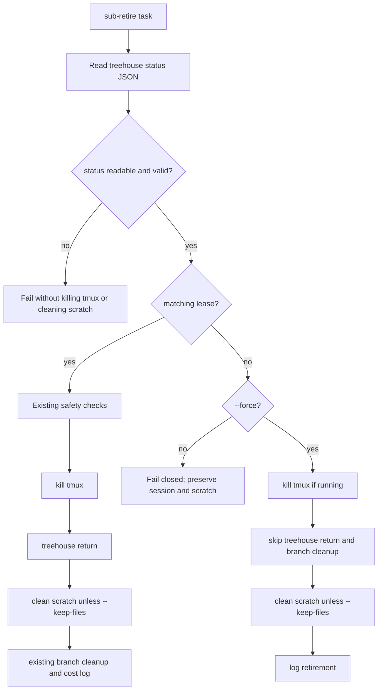

# Design: safe retirement after a treehouse lease disappears

## Abstract

Forensic evidence found that `gh pr merge --delete-branch` in the installed
GitHub CLI 2.101.0 removes the PR branch's linked worktree via `git worktree
remove`; the still-running child can therefore lose its directory before
Treehouse sees it. Treehouse's pool listing then heals state by dropping
entries whose paths no longer exist (`internal/pool/pool.go:415–424,
481–495`). This is not caused by a Treehouse prune/timer or this repository's
retirement scripts. `AGENTS.md` now warns against using `--delete-branch` while
a child worktree is live and directs operators to let normal retirement return
it first.

`scripts/sub-retire.sh` currently aborts as soon as `wt_for_task` returns no
path. That is safe, but it cannot clean up a still-running child after its
lease has already vanished. The shared helper also suppresses `treehouse
status` failures, so the caller cannot distinguish an absent lease from an
unreadable pool state.

Keep the command-line interface unchanged. `sub-retire.sh` will read and
validate the pool status itself. A valid status with no matching lease remains
a fail-closed error unless `--force` is explicit. In that forced recovery
case, it may stop the child's tmux session and clean task scratch files (unless
`--keep-files` is set), but it must not call `treehouse return` or clean
branches: it has no reliable worktree path or branch. A failed or malformed
status remains an error even with `--force`.

This is post-failure retirement recovery only. It does not prevent GitHub CLI
from removing a live child worktree when `--delete-branch` is used; the
operational documentation avoids that destructive flag, while the report
records the evidence and exact source locations.

## Interface and data flow

The existing CLI is the seam: `sub-retire.sh <task> [repo] [--force]
[--keep-files] [--no-branch-cleanup]`. No new flag or dependency is added.

## Implementation plan

1. In `sub-retire.sh`, obtain `treehouse status --json` with an explicit
   failure check, validate the array and each entry's string `lease_holder`
   and `path`, then resolve this task's lease.
2. For a valid missing lease, retain the current fail-closed behavior without
   `--force`, but explain that the operator must verify published work before
   retrying with `--force`.
3. With `--force`, retire the tmux/scratch/log portions, skipping both
   `treehouse return` and branch cleanup because the worktree and branch are
   unknown. Honor `--keep-files` as usual.
4. Extend the hermetic `tests/sub-retire.test.sh` stubs and add one test per
   scenario in `retire-missing-lease.feature`; run the complete shell suite and
   ShellCheck.
5. Independently audit the feature and changed source. Record any low-value
   design observations here; change code only for findings that are required
   by the specification or approved.

## Requirement trace

| Requirement | Design / implementation seam | Behavioral test |
|---|---|---|
| [REQ-1] | Refuse before tmux, worktree, or scratch cleanup when no lease and no `--force` | `Refuse missing-lease retirement without changing child state [REQ-1]` |
| [REQ-2] | Forced path stops the child, skips return, and skips branch cleanup when no lease | `Force-retire the child without returning an unleased worktree [REQ-2]` |
| [REQ-3] | Existing `--keep-files` option governs forced no-lease scratch cleanup | `Preserve task files during forced missing-lease retirement when requested [REQ-3]` |
| [REQ-4] | Read/validate status JSON before any destructive action | `Refuse forced retirement when treehouse status cannot be trusted [REQ-4]` |

## Files and best practices

- `scripts/sub-retire.sh`: keep the current CLI as the single seam; make
  missing-lease recovery explicit and keep destructive operations behind
  `--force`.
- `AGENTS.md`: warn against `gh pr merge --delete-branch` while a child
  worktree is live, document that `treehouse status` may reconcile pool state,
  and explain guarded missing-lease recovery.
- `tests/sub-retire.test.sh`: fake treehouse status, tmux, and GitHub in a
  temporary sandbox. Assert that unavailable state does not get mistaken for
  an absent lease and that forced recovery never returns/deletes an unknown
  worktree or branch.
- `specs/retire-missing-lease/retire-missing-lease.feature`: atomic observable
  behaviors [REQ-1] through [REQ-4].

The implementation deliberately leaves an orphaned directory or local branch
alone if treehouse has dropped its lease. That is safer than guessing which
path/branch belongs to the task. The operator may inspect and clean such an
orphan separately after confirming the PR and work are durable.

## Decision strengths and weaknesses

**Strengths:** status-read failures cannot trigger the forced fallback;
ordinary retirement remains fail-closed; `--force` never invents a worktree
path or branch; tests assert observable CLI effects with hermetic adapters.

**Weaknesses:** this only helps retire the child session after the lease is
gone. It cannot recover work that treehouse already removed, and it may leave
an unregistered directory or task branch for manual inspection. The task
operator must explicitly choose `--force` after verifying the durable copy.

## Audit report

- **Overview:** Independent audit re-read the feature and production source;
  no Strong recommendation was found. REQ-1 through REQ-4 are covered, and
  untrusted status is rejected before tmux or scratch changes.
- **Files:** `specs/retire-missing-lease/retire-missing-lease.feature`,
  `scripts/sub-retire.sh`.
- **Problem:** Status validation, lease detection, and worktree-path extraction
  are separate `jq` invocations, spreading related interpretation across a
  few lines.
- **Solution:** If status handling grows, consolidate these steps into one
  private operation returning a validated classification and optional path.
- **Benefits:** This may improve locality by keeping status interpretation in
  one place. The gain is small now; the current steps are clear and safe.
- **Before / after:**

  | Current | Possible future shape |
  |---|---|
  | Validate status, check for the lease, then extract its path separately. | One private operation classifies status and returns the validated result. |

- **Recommendation strength:** Speculative; no change is recommended for this
  task. No refactor was made.
