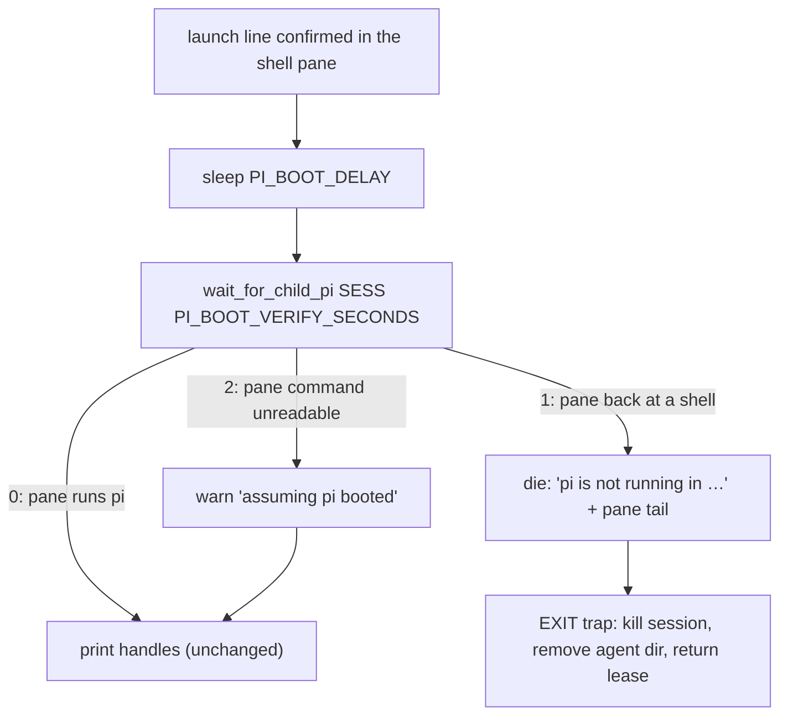

# Design: spawn boot verification (sub-spawn)

## Summary

`tmux_send_shell_line` confirms the *shell* ran the launch line: its evidence
is the pane changing after the Enter (`specs/fix-launch-confirm`). A pi that
dies immediately after the shell runs the line — an unknown `--model`, a broken
extension — satisfies that evidence exactly like a healthy boot. The spawn then
printed "Subsession spawned" plus the handles for a session whose pi was
already gone (observed twice on 2026-11-07: the model-not-found incident of
`specs/child-model-resolution`), leaving the orchestrator driving a dead pane
with no failure to react to.

After the boot wait the spawn now verifies the child pane is actually running
pi. If it is not, the spawn fails loudly, shows the pane's last lines as the
reason, and releases the lease, the session, and the agent directory through
its existing exit trap. If it is, nothing changes.

## Entities

- **`scripts/_sub-common.sh`** (modified):
  - `pane_command_in <target>` — `#{pane_current_command}`, empty when tmux
    cannot report it;
  - `pane_command_is_pi <command>` — non-empty and not a shell/other
    interactive non-TUI program (deny-list, case-insensitive). Moved here from
    `main-watch.sh` so the watcher and the spawn cannot disagree about what pi
    is (`main-watch.sh`'s `mw_command_is_pi` / `mw_pane_is_pi` now delegate);
  - `wait_for_child_pi <session> <seconds>` — 0 as soon as the pane is
    pi-like, 1 when the window expires with the pane still not pi-like, 2 when
    the pane's command cannot be read at all. Polls every 0.25 s;
    `seconds=0` checks once.
  - `PI_BOOT_VERIFY_SECONDS` (default 10) — the extra window for a slow boot.
- **`scripts/sub-spawn.sh`** (modified) — after `sleep "$PI_BOOT_DELAY"`:
  `wait_for_child_pi "$SESS" "$PI_BOOT_VERIFY_SECONDS"`; state 2 warns
  (`assuming pi booted`) and continues; any other non-zero dies with the
  pane tail (the EXIT trap kills the session, removes the agent dir, and
  returns the lease).
- **`specs/fix-worktree-trust-prompt/test_spawn_trust.sh`** (modified) — its
  pi stub now stays resident (`STUB_STAY_RESIDENT=1`, `exec sleep`) when it is
  booted inside a child pane, because a real pi keeps the pane; the direct
  stub call still returns and exits.
- **`tests/spawn-boot-verify.test.sh`** (new) — one test per scenario,
  hermetic (fixture git repo, fake tmux whose pane command is scripted, fake
  treehouse; `PI_BOOT_DELAY=0`).

## Behaviour and data flow

The failure text carries the pane tail (up to 20 lines), so the reason pi
exited — e.g. `Error: Model "…" not found` — is in the spawn's own output.

## Tests

`tests/spawn-boot-verify.test.sh` maps 1:1 onto
`specs/spawn-boot-verify/spawn-boot-verify.feature` ([REQ-43]…[REQ-47],
[REQ-49]). Every existing spawn suite keeps its fake pane (unreadable
command) and therefore keeps confirming the previous behaviour.

## Risks and limits

- A degraded tmux that cannot report a pane command (or a fixture pane) is
  treated as healthy: the verification is best-effort by contract, never a
  source of false failures.
- A pi that boots but is wedged *before* taking the pane looks like a failed
  boot and fails the spawn — the same outcome the orchestrator wants.
- The window is bounded: a machine slower than `PI_BOOT_VERIFY_SECONDS` fails
  the spawn loudly (with a clear message) rather than reporting a dead child.
