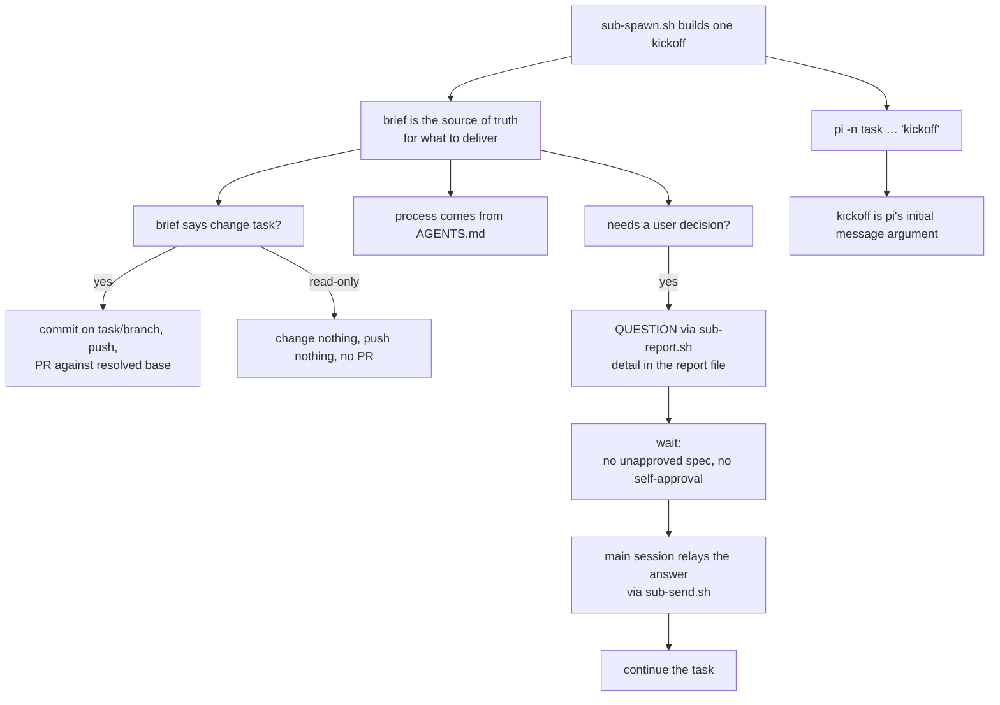

# Design: the spawn kickoff defers to the task brief

## Summary

`sub-spawn.sh` builds a single hardcoded kickoff and hands it to every child
as pi's initial message argument. The template ends with commit/push/PR
commands that fit a change task but contradict a read-only investigation
(live case: `fallback-auto-gap`, whose brief said "Read-only: change nothing,
push nothing, open no PR").

The fix keeps one template but makes it explicit that **the brief decides the
deliverable**: the kickoff names the brief as the source of truth for what the
task must deliver, points at this repository's `AGENTS.md` for the process
instead of enumerating the flow, and states both deliverable branches —
change (commit, push, PR against the resolved base) and read-only (change
nothing, push nothing, no PR). The report and DONE-notice contract is made
deliverable-neutral too (no mandatory PR link or PR number), so no part of
the message still assumes a change task. No mode flag, no brief parsing, no
per-task template: the wording is the contract, and the brief overrides it by
declaring which branch applies.

The same template also names the **QUESTION** channel: a child that needs
the user to decide something — in particular the spec-approval gate — asks
with `sub-report.sh <task> "QUESTION: <one-line question>"`, puts the detail
in its report file (plus a lavish HTML artifact when a picture beats prose),
and then stops and ends its turn until the answer arrives. The wait is
explicit and blocking: no implementing an unapproved `.feature`, no
self-approving the gate because nobody answered.
When the main session relays the answer with `sub-send.sh`, the child
continues from there.

**Scope:** only the kickoff text built in `scripts/sub-spawn.sh`. The launch
mechanism (kickoff as pi's initial message argument), the resolved-base
threading (`specs/spawn-base-fallback`), the watcher arms and every other
`sub-*` helper are untouched.

## Entities

| Entity | Change |
|---|---|
| `KICKOFF` (`scripts/sub-spawn.sh`) | reworded: brief is authoritative; `AGENTS.md` owns the process; change deliverables are the default, read-only deliverables override; report/DONE tail is deliverable-neutral; names the QUESTION channel and the wait rule |
| `specs/spawn-kickoff-brief/` | feature + this design, extended with `[REQ-27]`…`[REQ-30]` |
| `tests/spawn-kickoff-brief.test.sh` | suite extended with `[REQ-27]`…`[REQ-30]` |
| `AGENTS.md` | the spawn step and the brief-convention section document the deference |

## Behaviour and data flow

The child classifies its own brief at read time and the kickoff tells it that
classification is authoritative. A brief that is silent gets the change-task
default — exactly today's behaviour — so nothing regresses for the common
case; only the contradiction with an explicit read-only brief is removed.

The question channel is the interactive path: without it a child treats
`DONE`/`BLOCKED` as the only ways to reach the orchestrator, so a spec gate
either stalls forever or gets self-approved and folded into a late `DONE`.
The kickoff names the channel, the detail location, the lavish option, the
wait rule, and the resume path — all inside the same single-line argument, so
nothing about the transport changes (`specs/spawn-kickoff-brief`).

## Plan

1. Replace the `KICKOFF` assignment in `sub-spawn.sh`:
   - drop the enumerated flow (`atomic specs, implementation, code audit`)
     and point at `AGENTS.md` instead;
   - open with "the brief at `<path>` is the source of truth for what this
     task must deliver";
   - keep the commit/push/PR instruction but make it conditional on the
     brief being a change task, against `$BASE_BRANCH`;
   - add the read-only counterpart (change nothing, push nothing, no PR);
   - keep the report path, the no-external-notification rule and the
     `sub-report.sh` DONE/BLOCKED notice, with the report/notice contract
     made deliverable-neutral (no mandatory PR link or PR number).
   - add the QUESTION channel: ask with `sub-report.sh <task> "QUESTION:
     <one-line question>"`, put the detail in the report file, use a lavish
     HTML artifact when a picture beats prose, then stop and end the turn
     until the answer — no implementing an unapproved `.feature`, no
     self-approving the gate; continue when the answer is relayed back with
     `sub-send.sh`.
2. Extend `tests/spawn-kickoff-brief.test.sh`: the fake-`treehouse` /
   fake-`tmux` fixture captures the launch line the shell runs (the kickoff
   is an argument of it) and asserts the six original scenarios plus
   `[REQ-27]`…`[REQ-30]` for the QUESTION channel, the wait rule, the relay
   resume, and the retained notice/single-line guarantees.
3. Update `AGENTS.md`: the spawn step notes the kickoff defers to the brief,
   and the "Briefs never spell out the process flow" section carries the
   kickoff contract.
4. Stabilize the suite around the longer kickoff: the trust harness's pane
   capture reads the scrollback (so the typed launch line cannot scroll out
   of the non-vacuity check), and the new launch-line suite joins the
   model-agnostic guard (`tests/model-agnostic-tests.test.sh`).

## Proposed changes

| File | Change |
| --- | --- |
| `scripts/sub-spawn.sh` | reworded `KICKOFF` (deliverable split + QUESTION channel) |
| `tests/spawn-kickoff-brief.test.sh` | suite extended with `[REQ-27]`…`[REQ-30]` |
| `tests/model-agnostic-tests.test.sh` | the new launch-line suite joins the model-agnostic guard |
| `specs/fix-worktree-trust-prompt/test_spawn_trust.sh` | pane capture reads the scrollback, so a longer kickoff cannot push the typed launch line out of the non-vacuity check |
| `specs/spawn-kickoff-brief/` | feature + design extended with `[REQ-27]`…`[REQ-30]` |
| `AGENTS.md` | kickoff/brief contract in the spawn step and brief section |

## Best practices

- **The brief is the single source of truth.** No spawn flag and no brief
  convention can be forgotten; the child reads one document and the kickoff
  tells it that document wins.
- **One template, one place.** The deliverable contract lives in the same
  string `spawn-base-fallback` already threads `$BASE_BRANCH` into; no second
  kickoff variant to keep in sync.
- **Reuse the existing seam.** The launch line (`pi_launch_command`), the
  confirmed send (`tmux_send_shell_line`) and the report notice path are
  unchanged.
- **No flow steps in the kickoff.** Mirrors the brief rule: the child gets
  the process from the project's `AGENTS.md`. The QUESTION/wait rule is a
  decision guard, not a process step — it keeps the child on a gate it
  cannot approve itself.
- **No deliverable assumed in the tail.** The report/notice instructions name
  no PR link or PR number, so nothing after the two arms re-imposes the
  change-task default on a read-only child.

## Decision strengths and weaknesses

- **Strengths.** Minimal, localised reword; removes the contradiction by
  construction (the change command is explicitly conditional and the
  read-only command is spelled out); feature/fix children keep the exact
  commit/push/PR instruction the pattern depends on; nothing to configure.
- **Weaknesses.** A read-only brief that never says it is read-only still
  receives the change-task default; the kickoff cannot detect intent it was
  never told. That is today's behaviour and the smallest safe step — the
  alternative (parse a marker out of the brief) adds a brief convention and
  still needs a default. A future mode flag can layer on top without
  changing this contract.
