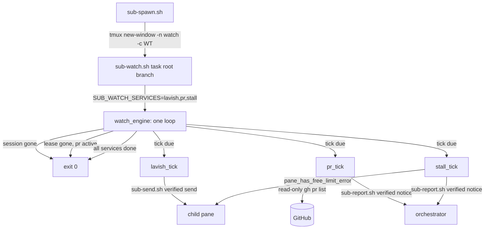

# Design: one watcher per child for every watching service

## Abstract

The per-child watching services were one tmux window each: a `lavish-watch`
window (`scripts/sub-lavish-watch.sh`) and a `pr-watch` window
(`scripts/sub-pr-watch.sh`), with a third window planned for the
free-provider stall detector. The consolidation adds
[`scripts/sub-watch.sh`](file://scripts/sub-watch.sh) — **one** per-child
process that runs the three services in **one loop** — and moves the service
implementations into a shared library,
[`scripts/_sub-watch.sh`](file://scripts/_sub-watch.sh):

| Service | What it does | Cadence knob | Bound knob |
| --- | --- | --- | --- |
| `lavish` | Wakes the child through the verified send when its Lavish artifact has queued feedback; never runs `lavish-axi poll` | `LAVISH_WATCH_INTERVAL` (2 s) | `LAVISH_WATCH_TICKS` |
| `pr` | Pushes merged / closed / submitted-review notices to the orchestrator through `sub-report.sh`; read-only `gh`, never types into the child | `PR_WATCH_INTERVAL` (30 s) | `PR_WATCH_TICKS` |
| `stall` | Detects the free-provider failure in the child's pane and pushes a notify-only `STUCK:` notice (run `sub-fallback.sh <task>` and nudge the child) | `STALL_WATCH_INTERVAL` (30 s) | `STALL_WATCH_TICKS` |

[`scripts/sub-spawn.sh`](file://scripts/sub-spawn.sh) arms exactly one
`watch` window per child instead of the two service windows; the old
standalone scripts stay as thin single-service wrappers over the same
library (they are the development entry points and the regression seam for
the per-service suites).

**One process, not a supervisor.** A supervisor launching the three scripts
as children would keep one window but three loops, three lifecycle checks,
and three independent dedupe states. The single loop is a small amount of
scheduling code and buys one place for the child's lifetime check, one place
for the lease check, and one process that retirement's `kill-session` takes
down. The per-service guarantees are unaffected because each service's tick
is the old loop body verbatim.

## Entities and seams

- [`scripts/_sub-watch.sh`](file://scripts/_sub-watch.sh) **(new)** — the
  engine and the three services:
  - **Engine** — `watch_engine <task> <root> [branch]`: resolves session,
    worktree, branch; parses the service selection; validates and resolves
    every active service's knobs once; then loops: session check → lease
    check (only when a lease-dependent service is active) → run each due
    service tick → stop when every active service is done or the child is
    gone. The loop sleeps the smallest active interval, and each service's
    period is `ceil(interval / loop-sleep)` in loop ticks (minimum 1), so
    the services share one clock without busy-waiting. A service's `*_TICKS`
    bound (0 = unbounded) counts its own scans and only stops that service.
  - **Lavish service** — `lavish_pending_sessions`, `compose_wake_message`,
    `lavish_wake_child` and `lavish_tick`, lifted from
    `sub-lavish-watch.sh` unchanged: a read-only scan of the Lavish state
    file, dedupe per queued batch, retry via `sub-send.sh` (the verified
    send), a pane that is not running pi is never typed into.
  - **PR service** — `lease_state`, `lease_alive`, `read_pr`,
    `review_signature`, `review_disposition`, `new_epoch`,
    `compose_terminal_notice`, `compose_review_notice` and `pr_tick`,
    lifted from `sub-pr-watch.sh` including the in-flight fixes: a
    `COMMENTED` review whose only comments are replies is the child's own
    words (`review_disposition` → `self-reply`, recorded handled), an
    unreadable attribution is retried, and a queued (steering) notice is
    delivery because `_sub-common.sh`'s `tmux_send_line` recognises pi's
    pending display. `pr_tick` marks the service done after the confirmed
    terminal notice.
  - **Stall service** — `stall_scan` (calls `pane_has_free_limit_error`,
    then classifies the signature), `compose_stall_notice`, `new_stall_epoch`
    and `stall_tick`: notify-only, dedupe per failure signature (kind +
    matching-line count in the scanned window), retry while unconfirmed,
    rewake after `STALL_WATCH_REWAKE_SECONDS` (900 s) for a failure that
    never clears, and a reset when the pane no longer shows the failure so a
    later stall notifies again.
  - `send_notice <task> <message> <label>` — the one delivery path; returns
    0 only when `sub-report.sh` confirmed the submission.
- [`scripts/sub-watch.sh`](file://scripts/sub-watch.sh) **(new)** — the
  unified watcher: `need`-checks the tools of the active services and calls
  `watch_engine` with all services selected.
- [`scripts/sub-lavish-watch.sh`](file://scripts/sub-lavish-watch.sh) and
  [`scripts/sub-pr-watch.sh`](file://scripts/sub-pr-watch.sh) **(modified)**
  — thin wrappers: parse their positional arguments and call `watch_engine`
  with `SUB_WATCH_SERVICES=lavish` / `pr`. Their external behaviour (argv,
  messages, exit codes, env knobs) is unchanged, so the existing suites keep
  guarding the service logic.
- [`scripts/sub-spawn.sh`](file://scripts/sub-spawn.sh) **(modified)** —
  replaces the two `new-window` calls with one `watch` window running
  `exec env SUB_WATCH_SERVICES=<list> scripts/sub-watch.sh <task> <root>
  <branch>`; reports one `watch:` handle; keeps `SUB_SPAWN_NO_WATCH=1` and
  `SUB_SPAWN_NO_PR_WATCH=1` (the latter removes `pr` from the list); a
  window that cannot start only warns.
- [`scripts/_sub-common.sh`](file://scripts/_sub-common.sh) **(unchanged)** —
  `repo_root`, `session_of`, `wt_for_task`, `pane_tail`,
  `pane_has_free_limit_error`, `_FALLBACK_ERROR_RE`, `info`/`warn`/`die` are
  reused; the pending-notice fix from the in-flight PR lives here.
- [`specs/lavish-wake/`](file://specs/lavish-wake/) and
  [`specs/pr-action-watch/`](file://specs/pr-action-watch/) **(modified)** —
  their spawn-wiring scenarios point at the unified watcher.
- [`AGENTS.md`](file://AGENTS.md) **(modified)** — the two per-service
  watcher sections become one "Child watcher" section.
- [`tests/unified-child-watcher.test.sh`](file://tests/unified-child-watcher.test.sh)
  **(written by the Test phase)** — one test per scenario, hermetic (fake
  `tmux`/`treehouse`/`gh` plus fixture Lavish state), mirroring the two
  existing watcher suites.

## Behaviour and data flow



Loop decision order (each iteration):

```
session gone?                     -> report and exit 0
pr active and lease gone?         -> report and exit 0
lease read failed?                -> warn once, keep watching
for each active service, if due:
    tick; a confirmed terminal PR notice marks only that service done
    *_TICKS bound reached?        -> mark only that service done
all active services done?         -> exit 0
sleep smallest active interval
```

## Plan

1. Add `scripts/_sub-watch.sh` with the engine and the three service ticks,
   moving the existing service bodies rather than rewriting them.
2. Add `scripts/sub-watch.sh` and turn `sub-lavish-watch.sh` /
   `sub-pr-watch.sh` into single-service wrappers over the library.
3. Replace the two watcher windows in `sub-spawn.sh` with the single `watch`
   window and the `SUB_WATCH_SERVICES` hand-off.
4. Update the two existing feature files' spawn scenarios and their design
   docs; update `AGENTS.md`.
5. Write `tests/unified-child-watcher.test.sh` and adjust the spawn-wiring
   sections of the two existing suites.

## Best practices taken

- **Reuse over rewrite**: each service tick is the old loop body; the PR
  service carries the in-flight dedupe fixes (self-reply attribution,
  unreadable-review retry, queued-notice confirmation in `_sub-common.sh`).
- **One clock, per-service periods**: the engine's loop sleeps the smallest
  active interval and runs each service every `ceil(interval / sleep)` ticks,
  so no service is polled faster than configured and none busy-waits.
- **Fail best-effort where the spawn expects it**: an unstartable window
  warns, a bad service name warns and is ignored, an empty selection exits 0.
  Invalid timing knobs still `die` loudly, as the standalone PR watcher did.
- **Observable behaviour is preserved**: message wording, notice templates,
  dedupe semantics, and knob names stay byte-compatible so the existing
  suites remain valid regression tests.

## Decision strengths and weaknesses

**Strengths** — one process and one window per child; one lifecycle and
lease check; the stall detector lands in the same delivery path and dedupe
idiom as the other services; the old scripts keep their suites green and
serve as development seams.

**Weaknesses** — a service tick that unexpectedly exits the loop (a bug, not
a designed path) now takes the other services down with it, whereas three
processes would isolate failures; the engine's tick scheduling is custom
code where three `sleep` loops were trivial; and the service-selection knob
(`SUB_WATCH_SERVICES`) is a new operational surface to document and keep
honest. The mitigation for the first is that every tick catches its own
transient failures (unreadable state/PR/lease warn and continue) exactly as
before, and the whole watcher is best-effort by contract: a dead watcher
window only loses automatic watching, never the child.
